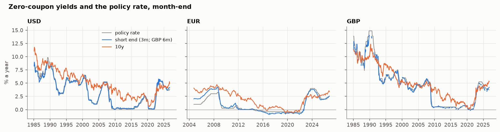
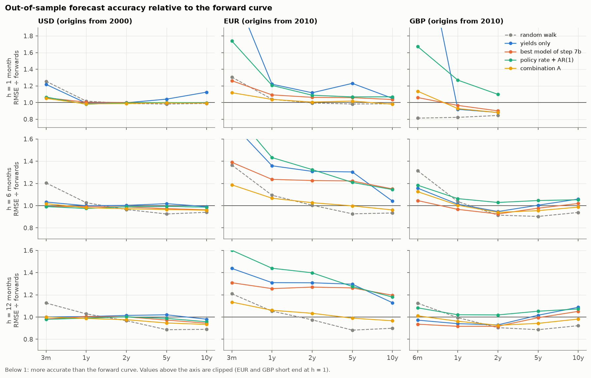
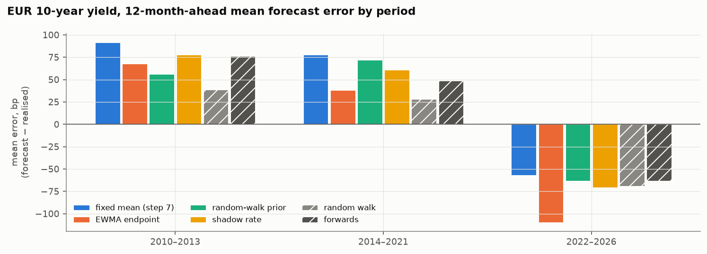
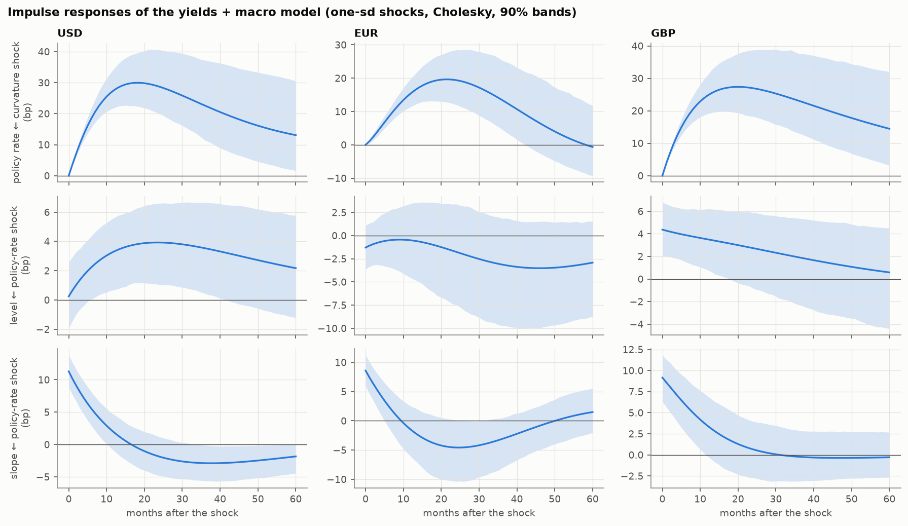
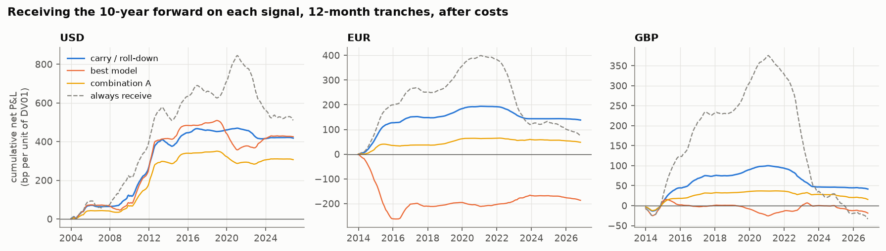

# yield-curve-kalman

Forecasting government yield curves as a **state estimation problem**. The
model treats the curve the way a navigation filter treats an aircraft: you
never observe the true state (the curve's level, slope and curvature), only
noisy measurements of it (yields at each maturity). A Kalman filter fuses
those measurements with macro data into an estimate of the hidden factors,
and updates it as each new observation arrives.

**Research question:** does macro information (real activity, inflation, the
policy rate) improve out-of-sample yield forecasts beyond what the curve
already contains, in USD, EUR and GBP?

## Results at a glance

**Short answer.** Across USD, EUR and GBP, 2000–2026, no model in this
project forecasts the yield curve significantly better than the forward
curve at 6 and 12 months. None of them makes more money than the trade
that needs no model at all: receiving the forward where the curve is steep
(carry and roll-down). Macro information helps in one place only: the
policy rate, in USD. The models do improve where the literature says they
should: at one month, at the short end, and at the zero lower bound. The
write-up below is the summary; every number links to a notebook and to the
detailed sections (§7.4–7.13).



### What was done

- **Data, public only:**
  - Fed (Gürkaynak–Sack–Wright), ECB and Bank of England zero-coupon
    curves.
  - Real-time macro data: ALFRED vintages for US activity and inflation,
    publication lags elsewhere, and FRED-MD with all 327 vintages for the
    panel factors.
  - Philadelphia Fed and ECB survey expectations.
  - The FRED-MD, EA-MD-QD and UK-MD macro panels.
- **Models:** the dynamic Nelson–Siegel state-space model estimated by
  Kalman-filter maximum likelihood (EM + exact score), with these
  extensions:
  - macro variables (Diebold–Rudebusch–Aruoba) and shrinkage;
  - AR(1) measurement errors;
  - shifting endpoints;
  - a random-walk prior;
  - a smooth shadow-rate model for the lower bound (extended Kalman
    filter);
  - a 4-factor dynamic Svensson model;
  - large-panel macro factors;
  - forecast combination and anchoring to forwards.
- **Out-of-sample protocol:**
  - re-estimated every year;
  - forecasts from filtered states only;
  - no data dated after the forecast origin;
  - origins from 2000 (USD) and 2010 (EUR, GBP);
  - horizons of 1, 6 and 12 months.
- **Benchmarks and tests:**
  - benchmarks: random walk and forward rates;
  - pairwise tests: Diebold–Mariano and Clark–West with HAC variances;
  - joint test: a model confidence set over every model, 58–70 per
    currency.
- **Guarding against data snooping.** Every grid of variants was written
  into this README and committed *before* it was run, and every variant is
  reported.
- **Trading:** carry, outright, curve, butterfly and cross-currency trades
  on the forward curve, with real-time sizing and costs (§7.13).
- **Engineering:**
  - 165 offline tests, including the filter against `statsmodels` to ~1e-9;
  - a compiled Kalman filter with steady-state shortcuts;
  - the full backtest grid in under 2 minutes on 8 cores, cached.

### Findings

**1. Nothing beats the forward curve at 6–12 months, and at the long end
the random walk does.** RMSE relative to the forward rate (below 1 = more
accurate; Diebold–Mariano: \* 10%, \*\* 5%, \*\*\* 1%):

| | Horizon | Random walk | Yields only | Best model | Policy rate | Combination |
|---|---|---|---|---|---|---|
| USD 3m | 1 month | 1.26\*\*\* | 1.22\*\*\* | 1.06\*\* | 1.07\*\* | 1.05\*\* |
| USD 3m | 12 months | 1.13 | 1.00 | 0.98 | 0.98 | 1.00 |
| USD 10y | 12 months | **0.89\*** | 0.98 | 0.95 | 0.96 | 0.93 |
| EUR 3m | 1 month | 1.31\*\*\* | 2.40\*\*\* | 1.26\*\*\* | 1.74\*\*\* | 1.12\*\*\* |
| EUR 10y | 12 months | 0.90 | 1.13 | 1.20 | 1.18 | 0.97 |
| GBP 6m | 12 months | 1.12 | 0.97 | 0.94 | 1.08 | 1.01 |
| GBP 10y | 12 months | 0.92 | 1.09\*\* | 1.05 | 1.07\* | 0.98 |

"Best model" is the step 7b choice per currency: the 4-factor Svensson
model with AR(1) errors (USD, GBP), and the shadow-rate model with AR(1)
errors (EUR). "Combination" is the real-time inverse-MSE average of model,
two-step VAR, forwards and random walk.

- **Short end.** Forward rates are the market's expected policy path, and
  no curve model beats them there.
- **Long end.** The forward rate overpredicts future long yields because
  it contains a term premium, so even a no-change forecast beats it at 10
  years. The models sit between the two.



**2. The fixes work where the literature says they should, and not
beyond.**

| Fix (section) | Where it helps |
|---|---|
| AR(1) measurement errors (§7.7) | One-month errors fall 10–33% at the ends of the curve in every currency. The plain fixed-λ models drop out of the one-month confidence set. |
| Shadow-rate model (§7.9) | EUR short end 26–33% better at one month and 18–22% at six; the zero-years bias falls by a third. |
| Second, short-end curvature factor (§7.11) | One-month errors −13% (USD), −48% (EUR), −14% (GBP); GBP short end level with forwards for the first time. |
| Tight random-walk prior (§7.10) | EUR 7–16% better at 6–12 months. |

None of these changes the 6–12-month verdict, and the confidence set
cannot separate the 22–70 models at those horizons.

**3. Mean reversion to a historical average was the main source of loss.**
The level reverted to the 1985 (USD), 2004 (EUR) or 1993 (GBP) average
while rates trended down for two decades. EUR 10y forecasts ran 78–92 bp
too high in 2010–2021, more than the random walk or the forwards.

- **Shifting endpoints** remove the trend bias but overshoot when rates
  turn, as in 2022.
- **Survey endpoints** stay too high: forecasters expected normalisation
  too.
- **The random-walk prior** helps most, a lesson that also explains why
  carry wins.



**4. Macro information: only the policy rate, only in USD, and the curve
leads policy.**

- **In USD, the policy rate improves forecasts at every maturity** at 12
  months (Clark–West), and adds P&L to curve trades:
  - the 2s10s steepener, t = 2.2;
  - the butterfly, t = 4.0 at 1 month and 2.0 at 6 months.
- **The full macro model overfits** (activity, inflation, policy rate:
  6–23% worse).
- **Large-panel factors add nothing,** even with real-time FRED-MD vintages.
- **In sample, the curve leads policy.** A curvature shock raises the
  policy rate by 20–30 bp, peaking after about 18–22 months, in all
  three currencies. Macro shocks explain only 4–10% of the factors' 12-month
  forecast variance.



**5. In P&L, carry wins.**
- **Receiving the 10-year forward on carry** earns a Sharpe ratio of 0.40
  in USD and 0.33 in EUR (12-month tranches, after costs), against 0.26 and
  0.07 for simply holding duration.
- **No model beats carry more often than chance:** t > 2 in 10 of 275
  comparisons, where about 7 are expected.
- **Butterflies and cross-currency spreads lose** for nearly every signal.
- **This agrees with Thornton & Valente (2012):** statistical
  predictability does not turn into economic value against forwards.



### Limitations and what would come next

- **Curve-implied returns, not contract returns:** no futures basis, roll,
  margin or financing spread. The source curves are smoothed fits.
- **Real-time data only partly.** EUR and GBP have no real-time vintages,
  so revisions are ignored there; USD is fully real-time.
- **Short samples outside the US.** Fifteen years of out-of-sample data for
  EUR and GBP, with one rate cycle at the lower bound and one sharp
  tightening.
- **Next steps:**
  - test the two candidate signals (the USD policy-rate curve trades and
    GBP 2y) on futures data;
  - add a time-varying term premium (an arbitrage-free model) to separate
    expectations from risk premia, which is what carry harvests;
  - evaluate density forecasts, not only point forecasts.

**Reproduce:** `python -m yck fetch`, then
`python -m yck backtest --ccy USD EUR GBP --all` (and `--accuracy`,
`--anchor`, `--shadow`, `--rwprior`, `--svensson`, `--factors`), then
`python -m yck figures`. Notebooks 01–11 hold every table.

Contents:

1. [Quick start](#1-quick-start)
2. [Project status](#2-project-status)
3. [Repository layout](#3-repository-layout)
4. [Data pipeline](#4-data-pipeline)
5. [Data findings and quirks](#5-data-findings-and-quirks-read-before-modelling)
6. [Model specification](#6-model-specification)
7. [Forecast evaluation protocol](#7-forecast-evaluation-protocol)
8. [Roadmap](#8-roadmap-next-steps-in-order)
9. [Conventions and decisions](#9-conventions-and-decisions-already-made)
10. [GitHub Actions and tooling](#10-github-actions-and-tooling)
11. [Troubleshooting](#11-troubleshooting)
12. [References](#12-references)

---

## 1. Quick start

Requirements: Python ≥ 3.10 and git. Run all commands from the repository
root (the folder containing this README).

```bash
# 1. Install the package in editable mode, with test dependencies
python3 -m pip install -e ".[dev]"            # add ",notebook" for matplotlib + jupyter

# 2. Create the local secrets file (git ignores it, so it is never committed).
#    Replace YOUR_KEY with the FRED API key from
#    https://fredaccount.stlouisfed.org/apikeys
echo "FRED_API_KEY=YOUR_KEY" > .env

# 3. Run the offline tests (no network needed)
python3 -m pytest -q

# 4. Download all public data and build the monthly panels (~2-5 minutes)
python3 -m yck fetch

# 5. Read the coverage report
cat data/processed/coverage.md
```

Useful variants:

```bash
python3 -m yck fetch --only USD          # one currency (USD, EUR, GBP; several allowed)
python3 -m yck fetch --refresh           # ignore the cache in data/raw and re-download
python3 -m yck probe-ecb ICP             # list ECB dataflows whose id/name matches "ICP"
python3 -m yck probe-ecb HICP "?"        # show the key dimensions of the HICP dataflow
python3 -m yck probe-ecb HICP "M...000000..ANR"   # list matching series and their last date
python3 -m yck backtest --ccy USD        # Kalman DNS out-of-sample forecasts -> data/results/ (cached, parallel)
```

Notes:

- `.env` is read automatically by `python -m yck` (see `src/yck/__main__.py`).
  Only `FRED_API_KEY` is needed. Without it, everything still runs except the
  ALFRED real-time vintages for USD, which are reported as FAILED in
  `coverage.md`.
- `data/raw/` (downloads) and `data/processed/` (outputs) are git-ignored and
  rebuilt by `python3 -m yck fetch`.
- If the repository lives inside OneDrive, OneDrive syncing the hidden `.git`
  folder can occasionally cause git "lock"/"file exists" errors. Pausing
  OneDrive sync while running git commands avoids this.

## 2. Project status

As of 11 Nov 2026. All Kalman results use the long-run mean μ fixed at the
real-time sample mean (§6.3).

| Stage | Status |
|---|---|
| Data pipeline (curves + macro, USD/EUR/GBP) | **Done.** Verified end-to-end on GitHub Actions; every source fetches and is current |
| Offline tests | **Done.** 165 tests (parsers, real-time panels, DNS, backtest, Kalman filter vs statsmodels and brute force, steady-state shortcuts vs the full recursion, EM, exact score, stationarity repair, shrinkage, DM/CW, model confidence set, impulse responses vs statsmodels, shifting endpoints, AR(1) errors and forward anchoring without look-ahead, panel parsers, EM-PCA and real-time factor rules, real-time combination weights, shadow-rate EKF vs Kalman, Ansley–Kohn map), all passing (`pytest -q`) |
| CI (tests on every push) and monthly data-fetch workflow | **Done** |
| Two-step Diebold–Li baseline (yields only) | **Done** (`src/yck/model/dns.py`). USD 1985–2000: factor/proxy correlations 0.97–0.999, fit RMSE 2–8 bp (3m: 8 bp) |
| USD two-step notebook (factor plots, first RW comparison) | **Done** (`notebooks/01_two_step_usd.ipynb`); first results below |
| Kalman filter + RTS smoother with missing observations | **Done** (`src/yck/model/kalman.py`). Matches statsmodels to ~1e-9 (log-likelihood, filtered/smoothed states and covariances), with gaps; 0.16–0.36 ms per filter + smoother pass on USD 1985– (§8, step 4d) |
| One-step maximum-likelihood DNS (yields only) | **Done** (`statespace_dns.py`, `notebooks/02_kalman_usd.ipynb`). EM + exact score, 1 bp noise floor, multistart, μ fixed at the sample mean, stationary estimates; every backtest in the project (`backtest --all`) ~1.5 min from scratch, seconds from cache |
| Forward-rate benchmark, Diebold–Mariano and Clark–West tests | **Done** (`eval/backtest.py`, `eval/stats.py`); USD results in §7.4. Optional SPF survey benchmark not done |
| Yields + macro model (Diebold–Rudebusch–Aruoba 2006), USD | **Done** (`statespace_dns.py`, `data/realtime.py`, `model/irf.py`, `notebooks/03_macro_usd.ipynb`): real-time macro, full / policy-rate-only / shrunk models, impulse responses with bands, variance decompositions, out-of-sample tests. Results in §7.4 |
| EUR and GBP, cross-currency comparison | **Done** (`notebooks/04_eur_gbp.ipynb`); results in §7.4 and below |
| Accuracy improvements from the literature | **Items 1–4 done** (`model/adjust.py`, `eval/combine.py`, notebooks 05–06, results in §7.7–7.8): AR(1) measurement errors fix the 1-month forecasts; shifting endpoints do not help on balance; anchoring to forwards fixes the EUR short end only; combinations are at or below forwards at the long end everywhere. Items 5–6 done: the shadow-rate DNS (`model/shadow.py`, notebook 07, §7.9) has large gains at the EUR short end, small in GBP, none in USD; the random-walk prior (notebook 08, §7.10) helps the EUR curve and GBP long end at τ = 0.03. Item 8 (dynamic Svensson, notebook 09, §7.11) done: a second, short-end curvature factor fixes the short-end fit and the one-month forecasts. Item 7 (macro factors from FRED-MD / EA-MD-QD / UK-MD, notebook 10, §7.12) done: no information beyond the policy rate. **Step 7b complete**; what was adopted is summarised at the end of §7.12 |
| Trading evaluation | **Done** (`eval/trading.py`, `notebooks/11_trading.ipynb`, results in §7.13): carry / roll-down is the strategy to beat (USD 10y Sharpe 0.40), and no model beats it more often than chance; the policy rate adds P&L to USD curve trades |
| Final write-up | **Done**: [Results at a glance](#results-at-a-glance) at the top of this README; figures from `python -m yck figures` (`src/yck/report.py`, `docs/figures/`) |

Latest verified coverage (month-end, output of `python -m yck fetch`):

| | Curve | Real activity | Inflation | Policy rate |
|---|---|---|---|---|
| **USD** | 1961-06 → 2026-10, no gaps | 1967-01 → 2026-09 | 1960-01 → 2026-09 | 1954-07 → 2026-10 |
| **EUR** | 2004-09 → 2026-10, no gaps | 1992-01 → 2026-08 | 1997-01 → 2026-10 | 1999-01 → 2026-10 |
| **GBP** | 1979-01 → 2026-10 (short-end gaps, see §5) | 1949-01 → 2026-08 | 1989-01 → 2026-09 | 1975-01 → 2026-10 |

USD ALFRED vintages: capacity utilisation 386 vintages (first 1996-11-15);
PCE price index 317 vintages (first 2000-08-01).

**First results (two-step DNS, USD, `notebooks/01_two_step_usd.ipynb`).**
Estimation from 1985, out-of-sample origins 2000-01 → 2026-10, re-estimated
monthly. RMSE relative to the random walk (< 1 = better than RW):

| | 3m | 12m | 24m | 60m | 120m |
|---|---|---|---|---|---|
| AR(1), h = 6 | 1.09 | 1.14 | 1.16 | 1.20 | 1.08 |
| VAR(1), h = 6 | **0.84** | **0.95** | 1.01 | 1.08 | 1.03 |
| AR(1), h = 12 | 1.06 | 1.10 | 1.15 | 1.26 | 1.17 |
| VAR(1), h = 12 | **0.88** | **0.96** | 1.02 | 1.12 | 1.07 |

The AR(1) baseline loses to the random walk after 2000. The VAR(1) wins
only at the short end. The main cause is bias: forecasts revert to a high
historical mean, so they ran too high in 2000–2015. For example, the mean
12-month-ahead error at 10y was +58 bp in 2000–07 and +80 bp in 2008–15
for the AR(1), against +20 / +31 bp for the RW. A rolling 10y window does
not fix this. Can macro information correct it? That is the question for
§6.4.

**One-step Kalman / ML DNS (`notebooks/02_kalman_usd.ipynb`).** In-sample
log-likelihood 13,284 (λ fixed) and 15,394 (λ estimated, 0.039), with a
1 bp noise floor, against 11,168 at the two-step estimates. Out of sample
(refit yearly, filtered states), h = 12:

| | 3m | 12m | 24m | 60m | 120m |
|---|---|---|---|---|---|
| Two-step VAR(1) | **0.88** | **0.96** | 1.02 | 1.12 | 1.07 |
| Kalman, λ fixed | 0.89 | 0.98 | 1.05 | 1.15 | 1.10 |
| Kalman, λ estimated | 0.92 | 0.99 | 1.04 | 1.12 | 1.12 |

Much better in-sample fit, no better forecasts: the Kalman model matches the
two-step VAR(1) but does not beat it. The reason is the same mean-reversion
bias. μ is fixed at the 1985-to-date mean of the level factor (5.4–7.9%
across refits), while the 10y yield was mostly 1–5% after 2000 (10y, h = 12,
2000–07: +51 bp, against +47 bp for the two-step VAR and +20 bp for the
random walk). With μ *estimated*, as in an earlier version, the bias was
larger (+61 bp) and every ratio 0.02–0.04 worse; estimated μ is barely
identified (§6.3).

**Yields + macro and the cross-currency comparison (`notebooks/03_macro_usd.ipynb`,
`notebooks/04_eur_gbp.ipynb`, details in §7.4).**

- **USD:** only the policy rate adds information. The 4-state model beats
  yields-only by Clark–West at every maturity at h = 12 (RMSE −1% to −3%)
  and is level with forwards (RMSE ratio 0.95–1.01, not significant). The
  full model with capacity utilisation and inflation overfits.
- **EUR:** every model loses to the random walk (Kalman models by 9–63%)
  and significantly to forwards, because forecasts revert to a 2004-onward
  mean the zero/negative-rate decade never returned to (10y, h = 12,
  2010–13: +92 bp too high).
- **GBP:** close to the random walk and forwards (ratio to forwards
  0.93–1.16), never significantly better; macro does not help.
- **In sample, the curve leads policy in all three currencies** (a
  curvature shock raises the policy rate by 20–30 bp at a 15–20 month peak),
  while macro shocks explain only 4–10% of the factors' 12-month forecast
  variance.
- **No model beats the forward curve significantly in any currency at 6 or
  12 months.**

**Accuracy improvements, step 7b items 1–2 (`notebooks/05_accuracy.ipynb`,
details in §7.7).** The grid of 54 variants was fixed before it was run, and
a model confidence set covers every model in the project.

- **AR(1) measurement errors** cut 1-month RMSE significantly at both ends
  of the curve in every currency. Examples: USD 3m −11 to −18%, 10y
  −11 to −13%; EUR 3m −20 to −33%; GBP 10y −16%. At h = 1 the 90% model
  confidence set keeps every AR(1) variant and drops the plain λ-fixed
  Kalman models. USD 10y against forwards goes from 1.13*** to 1.00. No gain at
  h = 12: the residuals' half-lives are 1–6 months.
- **Shifting endpoints** remove most of the rally bias (10y, h = 12,
  2014–21: USD +45 → +2 bp, EUR +78 → +38 bp), but the trailing endpoint
  overshoots when rates turn (2022–26: USD −56 → −117 bp). Net: no
  significant RMSE change. SPF survey endpoints make USD worse, and the
  ECB long-term HICP expectation leaves the EUR 10y bias unchanged.
- **Still nothing beats forwards or the random walk at h = 6–12**, and the
  confidence set cannot separate the models there.

**Step 7b items 3–4 (`notebooks/06_combination_anchor.ipynb`, details in
§7.8).**

- **Anchoring** the model's 3m–12m forecasts to forwards (exponential
  tilting) cuts EUR RMSE by 23–46% at 3m–2y (h = 6–12). It hardly moves the
  10y, and outside EUR it makes the long end worse (GBP 10y, h = 12:
  1.11–1.13 × forwards).
- **Combining** the model (with AR(1) errors) with the two-step VAR,
  forwards and the random walk gives the first forecasts at or below
  forwards at the 10y in every currency (h = 12: USD 0.93–0.94, EUR
  0.97–1.02, GBP 0.98–1.00). These are mostly not significant, and still
  1.05–1.13 × the random walk there.
- **Overall ranking** (pooled squared error over 30–42 models): a
  combination is best in USD at every horizon, forwards are best in EUR,
  and the random walk in GBP at h = 1 and 12.

**Step 7b item 6, smooth shadow-rate DNS (`notebooks/07_shadow_rate.ipynb`,
§7.9).** Opschoor & van der Wel's (2025) model, estimated by EKF.

- **In sample** it gains +535 to +1,058 log-likelihood points once the
  zero-rate years are in the sample.
- **EUR:** short-end RMSE against the linear model is −26 to −33% at
  h = 1 and −18 to −22% at h = 6, and the 2014–22 bias falls by a third.
  It still loses to forwards.
- **GBP:** small gains of 3–7%.
- **USD:** none at 6–12 months.

**Step 7b item 5, random-walk prior on A (`notebooks/08_rw_prior.ipynb`,
§7.10).**

- **Only the tightest prior (τ = 0.03) matters.**
- **EUR:** RMSE falls 7–16% at h = 6–12 at every maturity.
- **GBP:** 5–10y fall 4–10%.
- **USD:** almost no change, and the prior hurts the policy-rate model.

**Step 7b item 8, dynamic Svensson (`notebooks/09_svensson.ipynb`, §7.11).**

- **A fourth factor peaking at 9 months** cuts the short-end noise sd from
  16–20 to 1–8 bp, and one-month errors by 13% (USD), 48% (EUR) and 14%
  (GBP).
- **GBP short end:** level with forwards at one month for the first time,
  and the best GBP model at 6 months in the confidence set.
- **A long-end hump** only repeats what the AR(1) errors do.

**Step 7b item 7, macro factors from large panels
(`notebooks/10_macro_factors.ipynb`, §7.12).** One or two real-time factors
from FRED-MD (all vintages), EA-MD-QD and UK-MD add nothing beyond the
policy rate in USD. Two factors make EUR and GBP forecasts 5–17% worse.

**Trading evaluation (`notebooks/11_trading.ipynb`, §7.13).** Every
forecast was turned into trades against the forward curve: outright, curve,
butterfly and cross-currency, over 1-, 6- and 12-month horizons, after
costs.

- **Carry / roll-down is the strategy to beat**, with no model needed:
  Sharpe ratio 0.40 on the USD 10y and 0.33 on the EUR 10y (h = 12).
- **No model beats carry more often than chance:** 10 of 275 comparisons
  have t > 2, against about 7 expected.
- **The macro question:** the policy rate adds P&L to USD curve trades
  (steepener at h = 12, butterfly at h = 1 and 6). The full macro model does
  not.

## 3. Repository layout

```
config/data_sources.yaml    every series ID, URL and setting; fix broken IDs here, not in code
src/yck/
  __main__.py               CLI: `python -m yck fetch | probe-ecb | backtest`; loads .env
  data/http.py              requests session, retries, on-disk cache in data/raw
  data/sources.py           one parse_* (pure, unit-tested) + fetch_* per source; ECB probes; ALFRED as_of()
  data/curves.py            Svensson/Nelson-Siegel evaluation, month-end sampling
  data/build.py             orchestrates everything and writes data/processed + coverage.md
  data/realtime.py          real-time macro panels: ALFRED vintages (USD) or release lags, as known at each origin
  model/dns.py              Nelson-Siegel loadings, two-step Diebold-Li estimation, factor dynamics, forecasts
  model/kalman.py           Kalman filter (missing rows), log-likelihood, RTS smoother, smoother sufficient statistics (compiled)
  model/statespace_dns.py   ML DNS (yields only or yields + macro): transforms, EM, exact score, multistart L-BFGS-B, 1 bp floor, shrinkage prior
  model/irf.py              impulse responses (Cholesky, generalised), variance decompositions, bands from the observed information
  model/shadow.py           smooth shadow-rate DNS (Opschoor-van der Wel): EKF likelihood, Ansley-Kohn stationary map, forecasts
  model/macro_factors.py    real-time factors from large macro panels: transforms, EM principal components, vintages / ragged edge
  model/adjust.py           forecast adjustments outside the likelihood: shifting endpoints (EWMA, surveys), AR(1) measurement errors, tilting to forwards
  eval/backtest.py          recursive out-of-sample forecasts (no look-ahead), parallel cached refits, random walk, forwards, RMSE tables
  eval/stats.py             Diebold-Mariano (HLN) and Clark-West tests, model confidence set, ratio/significance tables
  report.py                 the README figures (`python -m yck figures` -> docs/figures/)
  eval/combine.py           forecast combination: equal and real-time inverse-MSE weights
  eval/grid.py              the standard and step 7b grids of backtests as one job (CLI `backtest --all | --accuracy | --anchor | --shadow | --rwprior | --svensson | --factors`, notebooks' `ensure_results`), combinations
notebooks/                  analysis notebooks 01-11, committed with outputs
docs/figures/               README figures, generated by `python -m yck figures`
scripts/notebooks/          generators of notebooks 03-11 and their takeaways (see the README there)
tests/                      offline tests: parsers (small samples in each source's real format), real-time panels, DNS, Kalman, backtest, stats, IRFs
.github/workflows/
  ci.yml                    pytest on every push / PR
  fetch-data.yml            full fetch on a GitHub runner (manual + monthly cron); coverage report in the log
  probe-ecb.yml             runs `yck probe-ecb` on a runner (for finding ECB keys)
data/                       raw/ and processed/ (git-ignored)
```

Further model and evaluation modules are planned in §8.

## 4. Data pipeline

### 4.1 Outputs (`data/processed/`)

| File | Content |
|---|---|
| `curves_{USD,EUR,GBP}.parquet` | Month-end zero-coupon yields in **percent, continuously compounded** (BoE: see 4.2). Index `date` = calendar month-end. Columns `3m, 6m, 9m, 12m, 15m, 18m, 21m, 24m, 30m, 36m, 48m, 60m, 72m, 84m, 96m, 108m, 120m` |
| `curves_ext_{USD,EUR,GBP}.parquet` | The same month-end curves at every maturity the forward-rate benchmark needs (§7.4): the grid, each horizon h in `forecast_horizons_months`, and each grid τ + h (1m–132m). GBP: only maturities the BoE publishes (61/73/85/97/109/121m are not, so 1-month forwards for τ ≥ 60m are missing) |
| `macro_{USD,EUR,GBP}.parquet` | Monthly `real_activity`, `inflation`, `policy_rate`, **latest vintage**, index = month-end. Transforms already applied (see table below) |
| `surveys_{USD,EUR}.parquet` | Quarterly survey expectations indexed by the first day of the survey quarter: USD `bond10`, `cpi10`; EUR `hicp_lt`. **Not yet aligned to publication dates**: use `yck.model.adjust.survey_endpoint`, which applies `survey_known_month` |
| `panel_{USD,EUR,GBP}.parquet` | Large monthly macro panels, latest vintage, raw values: FRED-MD (126 series), EA-MD-QD monthly (47), UK-MD (111). Transformation codes (McCracken–Ng convention) in `attrs["tcode"]`. EA-MD-QD is CC BY-NC (non-commercial) |
| `fredmd_vintages/YYYY-MM.parquet` | Every FRED-MD vintage, 1999-08 onwards (327 files), for real-time USD factors |
| `vintages_USD.parquet` | ALFRED real-time history, long format: `series_id, date, realtime_start, realtime_end, value` (`realtime_end` of a still-current vintage is set to 2262-04-11) |
| `coverage.md` | First/last date and in-range gaps for every series, plus cross-checks |

Load example:

```python
import pandas as pd
y = pd.read_parquet("data/processed/curves_USD.parquet")      # T x 17
m = pd.read_parquet("data/processed/macro_USD.parquet")       # T x 3
v = pd.read_parquet("data/processed/vintages_USD.parquet")
from yck.data.sources import as_of
tcu_as_seen_on = as_of(v[v.series_id == "TCU"], "2008-10-31")  # series as published that day
```

### 4.2 Sources

All free and public; exact IDs live in `config/data_sources.yaml`.

**Curves.** All sampled at the last available trading day of each month. The
unfinished current month is dropped.

| | Source | How the grid is built |
|---|---|---|
| USD | Fed, Gürkaynak–Sack–Wright (2007), `feds200628.csv`, daily from 1961 | Svensson curve evaluated from the published parameters `BETA0–3, TAU1, TAU2` at the grid maturities. Before 1980 GSW is plain Nelson–Siegel (BETA3/TAU2 missing), so the 4th term is dropped |
| EUR | ECB `YC` dataflow, AAA-rated euro-area central government, Svensson parameters `B.U2.EUR.4F.G_N_A.SV_C_YM.{BETA0..TAU2}`, daily from 2004-09-06 | Same Svensson evaluation. Cross-checked against the ECB's own published spot rates SR_1Y/5Y/10Y: max abs difference 0.003 / 0.008 / 0.006 pp |
| GBP | BoE nominal government liability curve (Anderson–Sleath spline), `glcnominalddata.zip`, daily from 1979 | Read directly from sheets "4. spot curve" (years) and "3. spot, short end" (months). Pre-2005 workbooks name them "4. nominal spot curve" / "3. nominal spot, short end"; both names are configured. **Only maturities the BoE publishes are used; no interpolation** |

**Macro.**

| | Real activity | Inflation | Policy rate |
|---|---|---|---|
| USD | FRED `TCU` capacity utilisation, level, **with ALFRED vintages** | FRED `PCEPI`, 12-month % change, **with ALFRED vintages** | FRED `FEDFUNDS`, monthly average, level (never revised) |
| EUR | ECB `STBS.M.I10.Y.PROD.NS0020.4D0.N.IX`: euro area (21) industrial production ex construction, SA + working-day adjusted, 12-month % change | ECB `HICP.M.U2.N.000000.4D0.ANR`: HICP all items, annual rate, changing composition | ECB `FM.D.U2.EUR.4F.KR.DFR.LEV`: deposit facility rate, month-end value |
| GBP | ONS `K222` (diop) index of production, 12-month % change | ONS `D7G7` (mm23) CPI annual rate | BoE IADB `IUDBEDR` Bank Rate, month-end value |

These follow DRA (2006), which uses capacity utilisation, annual PCE
inflation and the fed funds rate. EUR and GBP have no free vintage
history, so they use the latest vintage plus a conservative publication lag
(`release_lag_months` in the config: real activity 2, inflation 1, policy
rate 0). **The lag is not applied in the processed files.** It must be
applied in the forecasting code (§7.3).

**Surveys** (shifting endpoints, §7.7). Quarterly. A survey counts as known
from the end of the second month of its quarter (`survey_known_month`).

| | Series | Coverage |
|---|---|---|
| USD | Philadelphia Fed SPF `Median_BOND10_Level.xlsx`: median expected average 10y Treasury yield over the next 10 years | First-quarter surveys only, 1992– |
| USD | Philadelphia Fed SPF `Median_CPI10_Level.xlsx`: median expected average CPI inflation over the next 10 years | Every quarter, 1991Q4– |
| EUR | ECB `SPF.Q.U2.HICP.POINT.LT.Q.AVG`: longer-term (about 5 years ahead) HICP expectation, average of point forecasts | 1999– (some early years annual) |

## 5. Data findings and quirks (read before modelling)

1. **Common sample.** EUR curves start Sep 2004, which limits any
   three-currency comparison to 2004-09 onwards. USD (1961–) and GBP (1979–)
   can additionally be studied on long samples.
2. **GBP short-end gaps are genuine.** The BoE does not publish the 3m and 6m
   points on many dates (3m: 1980-08 → 2024-10 with 331 missing months in
   range; 6m: 116 missing; 9m: ~10; 12m: 1). They are left as NaN on purpose.
   The Kalman filter handles them by dropping missing rows from the
   measurement equation (§6.3). Do **not** interpolate or fill them; an
   invented observation would make the fit look better than it is. For the
   two-step baseline, fit each month's cross-section on the maturities
   available that month.
3. **USD short end vs T-bills.** GSW 3m is 0.26 pp above `DTB3` on average
   (6m: 0.17 pp above `DTB6`). Expected: bills are quoted on a discount basis
   and GSW excludes bills, so its fit below ~1y is extrapolated. Keep GSW for
   consistency, and mention this in the write-up as a robustness point.
4. **ECB dataflows changed in 2026.** The old `ICP` (HICP) and `STS`
   (industrial production) dataflows froze at Dec 2025 and Sep 2025. The
   replacements are `HICP` and `STBS`, with different key structures
   (already configured). If an ECB series stops updating again, use
   `python -m yck probe-ecb` (§1) or the "probe ECB key" workflow to find the
   new key.
5. **Month-end alignment.** Curves are the last trading day of each month.
   Macro observations are indexed to the end of their reference month, but
   are *released* later (§7.3).
6. **Units.** All yields and rates are in percent (4.25 = 4.25%).
   Maturities are in months in column names; the DNS loadings in §6 use
   months.

## 6. Model specification

Notation: $y_t(\tau)$ is the yield at maturity $\tau$ (months) at month $t$.
The grid is the 17 maturities $\tau \in \{3,\dots,120\}$.

### 6.1 Dynamic Nelson–Siegel measurement

$$
y_t(\tau) = L_t + S_t\,\frac{1-e^{-\lambda\tau}}{\lambda\tau}
+ C_t\left(\frac{1-e^{-\lambda\tau}}{\lambda\tau} - e^{-\lambda\tau}\right) + \varepsilon_t(\tau)
$$

In vector form, $y_t = \Lambda(\lambda) f_t + \varepsilon_t$ with
$f_t = (L_t, S_t, C_t)'$ and $\Lambda$ of size 17 × 3.

### 6.2 Two-step Diebold–Li (2006) baseline (do this first)

1. Fix $\lambda = 0.0609$. This is Diebold–Li's value for maturities in
   months; it puts the peak of the curvature loading at about 30 months
   (29.4 exactly).
2. For each month, regress the cross-section of yields on $\Lambda$ by OLS,
   using only the maturities observed that month, to get
   $\hat f_t = (\hat L_t, \hat S_t, \hat C_t)$.
3. Fit a VAR(1) to $\hat f_t$, or three separate AR(1)s, which is DL's
   preferred forecasting specification:
   $\hat f_{t+h} = \hat\mu + \hat A^{h}(\hat f_t - \hat\mu)$.
4. Forecast yields as $\hat y_{t+h|t} = \Lambda \hat f_{t+h|t}$.

Sanity checks: $\hat L_t$ should track the 10y yield, $-\hat S_t$ the
10y–3m spread, and $\hat C_t$ roughly $2y_{24m} - y_{3m} - y_{120m}$.
Report the fit RMSE by maturity (DL get ~5–10 bp for USD).

### 6.3 One-step state-space (Kalman filter, maximum likelihood)

State equation (VAR(1) in deviations from the mean):

$$
f_t - \mu = A (f_{t-1} - \mu) + \eta_t, \qquad \eta_t \sim N(0, Q)
$$

Measurement equation:

$$
y_t = \Lambda(\lambda) f_t + \varepsilon_t, \qquad \varepsilon_t \sim N(0, H),\ H \text{ diagonal}
$$

Implementation notes:

- **Parameters:** $A$ (9), $Q$ via its Cholesky factor (6),
  $\log \operatorname{diag}(H)$ (17), and $\lambda$ (1, estimate it as
  $\exp$ of a free parameter, or fix it at 0.0609 first).
- **Long-run mean $\mu$: fixed at the sample mean** (default since 11 Nov
  2026, `fit_dns_mle(mu="sample")`; `mu="mle"` estimates it). At each refit,
  $\mu$ is the mean of the month-by-month OLS factors and of the observed
  macro series *up to the origin*, so there is no look-ahead. Why: near a unit
  root $c = (I - A)\mu$ barely depends on $\mu$, so the ML estimate is not
  identified. On GBP 1993–2012 it was −152% for Bank Rate and −93% for the
  level, the optimiser stopped at the stationarity cap, and repeated runs
  scattered by ~260 log-likelihood points. With $\mu$ fixed every refit is
  interior (largest spectral radius in the whole grid 0.998), runs from
  different starts agree exactly, and the grid fits ~3× faster. The
  estimated μ was also behind the USD mean-reversion bias (§2: μ of 6–8%).
- **Initial state:** the unconditional mean $\mu$, with the unconditional
  covariance from the discrete Lyapunov equation
  ($P_0 = A P_0 A' + Q$, `scipy.linalg.solve_discrete_lyapunov`).
  If $A$ is not stable, the filter falls back to a diffuse prior (large
  $P_0$) so that any trial value can be evaluated. That fallback makes the
  likelihood jump *up* at the unit circle, and on short or trending samples
  the optimiser used to stop at explosive $A$ (USD shrinkage models, EUR,
  GBP). Estimates are therefore required to be stationary: the search runs
  unrestricted, and a run that ends explosive is redone with explosive values
  rejected, and on the boundary surface if the cap binds
  (`statespace_dns._fit_from`). With μ fixed (below) neither happens in the
  current grid.
- **Missing data:** at each $t$, keep only the rows of $y_t$, $\Lambda$ and
  $H$ for observed maturities; skip the update entirely if none are
  observed. This is how the GBP short-end gaps are handled.
- **Likelihood:** the prediction-error decomposition, summing
  $-\tfrac12[\log|F_t| + v_t' F_t^{-1} v_t + n_t \log 2\pi]$. Maximise with
  EM (Shumway–Stoffer), then L-BFGS-B with the exact score (Fisher's
  identity: the gradient of the expected complete-data log-likelihood, from
  one smoother pass), from the two-step estimates plus random perturbations
  (6 starts). Measurement-noise sd is bounded below by **1 bp**: without the
  floor, some GSW maturities are fitted to ~0.01 bp, and the likelihood is
  then too ill-conditioned to maximise reliably (§8, step 4b).
- Write a small, own Kalman filter (numpy) and test it against
  `statsmodels.tsa.statespace` on simulated data. The custom code is part
  of the project's value and needs to handle missing rows.
- **Smoother:** a Rauch–Tung–Striebel smoother, for plotting factors only.
  Forecasts must use **filtered** states.

### 6.4 Yields + macro (Diebold–Rudebusch–Aruoba 2006)

The state becomes $x_t = (L_t, S_t, C_t, \mathrm{CU}_t, \mathrm{INFL}_t, \mathrm{RATE}_t)'$:
the three latent factors plus real activity, inflation and the policy rate.

- **State:** $x_t - \mu = A (x_{t-1} - \mu) + \eta_t$, with $A$ 6×6 and
  $Q$ 6×6 (full, or block-restricted as in DRA).
- **Measurement:** the 17 yields load on the first three states via
  $\Lambda$. The 3 macro variables are observed **without error**: they
  load 1:1 on their own state, with zero measurement variance. In
  practice, use a tiny variance such as 1e-8 to keep $F_t$ invertible.
- **Compare:** yields-only (§6.3) against yields + macro. Report the
  estimated $A$ and impulse responses (do macro shocks move the factors,
  and the factors the macro variables?) and the variance decompositions,
  as DRA do.
- **Nesting:** the yields-only model is the yields + macro model with the
  off-diagonal blocks of $A$ (macro → factors) set to zero. That makes the
  out-of-sample comparison a **nested** one, which is why Clark–West is
  used (§7.2).

## 7. Forecast evaluation protocol

### 7.1 Design

- **Horizons** h = 1, 6, 12 months. 6 and 12 are the headline results.
- **Recursive (expanding) estimation,** re-estimated every month, or every
  12 months to save time. A rolling 10-year window is the robustness check.
- **Out-of-sample periods:** USD 2000-01 onwards (limited by ALFRED vintage
  coverage, §2). EUR and GBP from 2010-01, so there are ≥ 5 years of
  estimation data for EUR. Also report the common window from 2010-01 for
  all three.
- **Error metric:** RMSE in basis points, by maturity and horizon.

### 7.2 Benchmarks and tests

| Comparison | Test | Why |
|---|---|---|
| Any model vs **random walk** ($\hat y_{t+h} = y_t$) or **forwards** | Diebold–Mariano (1995) with the Harvey–Leybourne–Newbold (1997) small-sample correction, two-sided | RW and forwards are the standard hard-to-beat benchmarks; not nested in DNS |
| **Yields + macro vs yields-only** | **Clark–West (2007)**, one-sided | Nested models: under the null, the larger model's extra parameter noise biases plain MSE comparisons against it |

Clark–West adjusted loss differential, with model 1 the small (nested)
model and model 2 the large one:

$$
\hat f_{t+h} = e_{1,t+h}^2 - \left[e_{2,t+h}^2 - (\hat y_{1,t+h} - \hat y_{2,t+h})^2\right]
$$

Regress $\hat f$ on a constant with HAC standard errors (lag h−1, see below)
and reject the null of equal accuracy if t > 1.282 (10%) or t > 1.645 (5%).

**Variance estimator (`src/yck/eval/stats.py`).** h-step forecasts made
monthly overlap, so loss differentials are MA(h−1). The variance of their
mean uses autocovariances up to lag h−1 with **equal (rectangular) weights**,
as in Diebold & Mariano (1995), which is exact for that structure; Bartlett
is the fallback if the estimate is not positive. Newey–West's Bartlett
weights shrink those autocovariances, and in simulation (300 observations,
h = 12) a nominal 5% test with them rejected 8–11% of the time. The
rectangular estimator with the HLN correction rejects 5.5–6.5%
(`tests/test_stats.py` checks this).

### 7.3 Real-time macro (no look-ahead)

- **USD:** at forecast origin $t$ (a month-end), build each vintaged macro
  series with `as_of(vintages, t)`, which returns the series exactly as
  published on that date. The last available reference month is then
  usually t−1 or t−2. Because the state equation needs a value at every
  $t$, treat the not-yet-released months as **missing observations** in
  the measurement equation (the filter handles this). Do not forward-fill.
- **EUR / GBP:** use the latest vintage, but set the last
  `release_lag_months[var]` months before each origin to missing. This
  approximates what was known at the time; state it clearly as a
  limitation.
- `FEDFUNDS`, the ECB DFR and Bank Rate are known at month-end (lag 0).
- **Withdrawn history.** Around BEA comprehensive revisions ALFRED records
  most of the PCE price index as missing until it is republished on the new
  basis (23 Dec 2003 – 4 Jan 2004, and 4 Aug 2009). Taken literally, the
  2003-12 origin would have no inflation data at all. The panel uses the last
  complete vintage instead (`realtime.as_of_complete`), which is what a
  forecaster then actually had.
- **Size of revisions (USD, 2000–2026, latest known value at each origin vs
  today's vintage):** capacity utilisation mean |revision| 0.98 pp (max
  2.8 pp, about a quarter of its standard deviation); core PCE inflation
  0.18 pp.

### 7.4 Market and survey benchmarks

The random walk is a statistical yardstick. A user of the model would
instead ask whether it beats **what the market already prices**.

- **Forward rates (all currencies).** The curve at origin $t$ implies a
  forecast of every future yield. With continuously compounded zero yields
  in months,
  $$
  F_t(h, \tau) = \frac{(\tau + h)\, y_t(\tau + h) - h\, y_t(h)}{\tau}
  $$
  is the market-implied forecast of $y_{t+h}(\tau)$. Short-rate futures
  (SOFR, fed funds, €STR, SONIA) price essentially the same quantity, up to
  a small convexity adjustment, but their history is licensed. Forwards
  computed from the public curves keep the public-data rule. GSW and ECB
  curves are evaluated from their parameters at the extra maturities needed
  (e.g. 132m for the 10y yield 12 months ahead). For the BoE, use the
  published maturities (to 40y). The pipeline stores the needed maturities
  in `curves_ext_{CCY}.parquet`; `eval.backtest.forward_forecasts` computes
  the forwards. All three sources are continuously compounded. For the BoE
  this was verified: forwards implied from its spot curve match its
  published forward curve to < 0.1 bp, whereas semi-annual compounding
  would be off by 6–9 bp.
- **Expected result.** Forwards usually forecast *worse* than the random
  walk, because they include a term premium (Fama–Bliss 1987,
  Campbell–Shiller 1991). Diebold–Li (2006) find DNS beats forwards.
- **USD result (2000–2026).** That holds only from 5y out (RMSE ratio to
  RW 1.06–1.13 at h = 6, 12). At the short end forwards *beat* the random
  walk (3m: 0.80 / 0.83 / 0.89 at h = 1 / 6 / 12), so the market's priced
  path for policy rates was informative. The best yields-only model (two-step
  VAR(1)) is within about ±1% of forwards at most points. Its clearest
  edge is the 10y at h = 12 (RMSE 5% below forwards).
- **Significance (HLN-corrected DM, USD 2000–2026).** At h = 6 and 12,
  *nothing* significantly beats the random walk. The short-end gains
  (VAR(1) 3m: 0.84 / 0.88) are not significant. Only at h = 1 do forwards
  (3m: 0.80, 1%) and the VAR(1) (3m: 0.86, 1%) beat it. **No yields-only
  model beats forwards at any maturity or horizon.** At h = 1 they are
  significantly worse at 3m and 5y; at h = 6 and 12 the VAR(1) is
  statistically level (ratios 0.95–1.01). The DL AR(1) is significantly
  worse than both benchmarks almost everywhere. In other words, the curve
  alone contains nothing the market has not already priced, which makes
  the macro model (§6.4) the real test.
- **Yields + macro, first results (USD, real-time macro).** The full DRA
  model (6 states, 74 parameters with μ fixed; Kalman, λ fixed) is *worse*
  than yields-only: RMSE ratio to RW at h = 12 is 0.97 / 1.06 / 1.13 / 1.22 /
  1.23 (3m / 12m / 24m / 5y / 10y), significantly worse than RW at 2y+.
  Clark–West finds no gain from macro at h = 12, only faint short-end
  signal at h = 6 (p 0.05–0.09). The likely cause is overfitting:
  36 VAR coefficients, most weakly identified. It is also numerically
  fragile: two fits within 0.7 log-likelihood points of each other can give
  12-month forecasts up to ~150 bp apart (§8, step 4d). A *parsimonious* version
  supports this. A two-step VAR on (level, slope, curvature, fed funds)
  beats the yields-only VAR by Clark–West at the short end (3m and 12m at
  h = 6, 12, p ≤ 0.05). Its RMSE ratios to RW are the best so far
  (3m 0.81 / 0.86, 12m 0.93 / 0.95 at h = 6 / 12), and for the first time
  it is below forwards (0.95–0.99), though not significantly. So macro
  information helps the short end when the model is small enough to
  estimate it.
- **Restricted and shrunk macro models (USD, Kalman, real-time macro, μ fixed).**
  RMSE relative to yields-only Kalman, Clark–West p in brackets where < 0.10:

  | | 3m | 12m | 24m | 5y | 10y |
  |---|---|---|---|---|---|
  | Policy rate only, h = 6 | 0.96 (0.02) | 0.98 (0.03) | 0.99 (0.07) | 0.99 | 1.01 |
  | Policy rate only, h = 12 | 0.98 (0.03) | 0.99 (0.05) | 0.99 (0.05) | 0.98 (0.06) | 0.97 (0.07) |
  | All 3, shrunk τ = 0.01, h = 12 | 1.01 | 1.00 | 1.00 | 1.02 | 1.03 |
  | All 3, shrunk τ = 0.03, h = 12 | 1.12 | 1.10 | 1.09 | 1.08 | 1.13 |
  | All 3, shrunk τ = 0.1, h = 12 | 1.14 | 1.12 | 1.10 | 1.07 | 1.12 |
  | All 3, shrunk τ = 0.3, h = 12 | 1.11 | 1.10 | 1.09 | 1.07 | 1.12 |
  | All 3, unrestricted, h = 12 | 1.10 | 1.09 | 1.08 | 1.06 | 1.12 |

  The **policy rate** adds significant information, at every maturity at
  h = 12. Capacity utilisation and inflation do not help out of sample:
  shrinking their links towards zero (a Minnesota-style prior on both the
  lagged cross-terms of A and the factor–macro shock covariance, so that
  τ → 0 is exactly yields-only) only gets back to yields-only accuracy, and
  any weight on them makes forecasts worse. The full τ grid is reported, and
  no τ beats the policy-rate model, so the choice of τ involves no data
  snooping. **No model beats forwards significantly.** The best (policy
  rate only) is level with them: RMSE ratio 0.98–1.01 at h = 6 and
  0.95–1.00 at h = 12. (An earlier version of this table came from fits
  where 17 of 27 τ = 0.01 refits had explosive A; see §6.3.)
- **Why so little? Impulse responses and variance decompositions** (USD
  1985–2026, latest vintage, `notebooks/03_macro_usd.ipynb`; Cholesky order
  capacity utilisation, inflation, fed funds, level, slope, curvature; 90%
  bands from the MLE's asymptotic distribution). As in DRA (2006), the
  curve leads the macro economy more than the reverse. Curve shocks explain
  about three quarters of the fed funds rate's 12-month forecast variance
  (curvature alone half). A slope shock (short rates up relative to long)
  lowers inflation by about 10 bp over 6–24 months. In the other direction,
  macro shocks explain only 1–10% of the factors' forecast variance at
  1–12 months (12–32% at 5 years). An inflation shock lifts the level by
  about 5 bp, and activity and policy shocks move mostly the short end. So
  at forecasting horizons, what the curve does not already contain is mostly
  the policy rate, which matches the out-of-sample result. Generalised
  (order-free) responses agree on these links. A generalised fed funds shock
  raises activity and inflation, because it includes the macro news the Fed
  reacts to, which is why a recursive identification is needed.
- **EUR and GBP (2010–2026, `notebooks/04_eur_gbp.ipynb`).** EUR is
  estimated from 2004-09 (start of the ECB curve), GBP from 1993-01
  (inflation targeting). EUR/GBP macro data have no vintages, so the panels
  use release lags (§7.3). The GBP short end is evaluated at 6m: the BoE
  published its 3m point in only 39 of the 202 months since 2010, almost all
  in 2010–12 when Bank Rate sat at 0.5%.
  - *EUR:* the Kalman models' RMSE is 9–63% above the random walk at
    h = 6, 12, and forwards beat them significantly at every maturity up to
    5y. At h = 12 the 10y forecasts ran +92 bp too high in 2010–13 and +78 bp
    in 2014–21 (random walk: +39, +28): they revert to a level mean of
    2.3–4.3%, which the zero/negative-rate decade never returned to. The
    two-step VAR(1) reverts less and is the best EUR model (1–26% above the
    random walk). The policy rate helps only one month ahead.
  - *GBP:* the yields-only Kalman model beats the random walk at 6m
    (0.86–0.88), is level at 1–2y and significantly worse at 10y
    (1.13–1.18). Against forwards its ratio is 0.93–1.16, never
    significantly below 1. Macro variables do not help.
  - *In sample* the pattern of USD repeats: a curvature shock raises the
    policy rate by 20–30 bp at a 15–20 month peak in all three currencies,
    curve shocks explain 45% (EUR) to 73–76% (USD, GBP) of the policy rate's
    12-month forecast variance, and macro shocks only 4–10% of the factors'.
- **Cross-currency summary (common window, origins 2010-01 onwards; mean
  RMSE ratio over 6m, 12m, 24m, 5y, 10y).**

  | | USD h=6 | USD h=12 | EUR h=6 | EUR h=12 | GBP h=6 | GBP h=12 |
  |---|---|---|---|---|---|---|
  | Yields-only Kalman / RW | 0.95 | 0.96 | 1.26 | 1.30 | 1.02 | 1.03 |
  | Yields-only Kalman / forwards | 1.00 | 0.99 | 1.31 | 1.28 | 1.04 | 0.99 |
  | Two-step VAR(1) / forwards | 0.99 | 0.99 | 1.10 | 1.12 | 1.04 | 0.98 |
  | Policy rate only / forwards | 0.98 | 0.98 | 1.33 | 1.35 | 1.09 | 1.05 |

  **No model beats the forward curve significantly in any currency at 6 or
  12 months.** The forward curve already embeds the expected policy path; a
  statistical model that reverts to a historical mean adds error whenever
  rates trend (EUR), and macro variables beyond the policy rate add little
  that the curve has not already priced.
- **Surveys (USD, optional).** Philadelphia Fed Survey of Professional
  Forecasters: quarterly 3m T-bill and 10y Treasury forecasts (free).
- Test every model against each benchmark with Diebold–Mariano (§7.2).

### 7.5 Trading evaluation (economic value)

Lower RMSE does not by itself mean money can be made. A rates position
already pays or earns the forward, so its P&L depends on the realised rate
**relative to the forward**, not to today's rate. The trading signal is
therefore

$$
s_t(h, \tau) = F_t(h, \tau) - \hat y_{t+h|t}(\tau)
$$

$s > 0$: the market prices higher rates than the model expects, so go long
duration (receive fixed or buy futures); $s < 0$: the opposite. The random
walk itself implies a trade, **carry / roll-down** (receive the term
premium), and that is the bar a model must clear.

- **Returns without licensed data.** h-month holding-period excess returns
  of zero-coupon bonds come straight from the curves:
  $rx_{t+h}(n) = n\,y_t(n) - (n-h)\,y_{t+h}(n-h) - h\,y_t(h)$ (in % over
  the period, maturities in months). These approximate futures and swap
  P&L. Real contracts add basis, roll and margin effects; state this as a
  limitation.
- **Strategies, mapped to DNS factors:**

  | Strategy | Factor | Instruments it stands in for |
  |---|---|---|
  | Short-rate path vs forwards | short end (3m–12m) | SOFR / fed funds, €STR / Euribor, SONIA futures |
  | Duration timing | level | Treasury TU/FV/TY, Schatz/Bobl/Bund, Gilt futures; swaps |
  | Steepener / flattener, DV01-neutral | slope | futures pairs, swap curve trades |
  | Butterfly (e.g. 2s5s10s) | curvature | three-leg futures or swaps |
  | Cross-currency relative value | level/slope spreads | USD vs EUR vs GBP |

  Factor-neutral portfolios are built from the Nelson–Siegel loadings, so
  that each portfolio is exposed to one factor only.
- **Sizing.** Position size is proportional to signal divided by forecast
  variance. The Kalman model gives the forecast covariance
  $Z P_{t+h|t} Z' + H$. Trade only when $|s|$ exceeds costs plus a
  multiple of the forecast's standard error. Measure positions in DV01 and
  target a fixed portfolio volatility.
- **Benchmarks:** buy-and-hold duration, carry / roll-down (the
  random-walk view), yields-only vs yields + macro.
- **Metrics:** Sharpe ratio, maximum drawdown, hit rate, turnover,
  certainty-equivalent return, all after costs (assume ~0.25–0.5 bp per
  trade for short-rate futures and <0.5 bp for bond futures; report
  sensitivity to the assumption).
- **Literature:** Thornton & Valente (2012) find that statistical
  predictability of bond returns gave no economic value over forwards.
  Gargano, Pettenuzzo & Timmermann (2019) find value when macro information
  is used. The research question (does macro help?) is answered both in
  RMSE and in P&L.
- **Caveats to report:** the mean-reversion bias of §2 would have kept a
  model short duration through the 2000–2015 bond rally; regime changes
  (zero lower bound, 2022 hikes); GSW curves are smoothed and exclude
  on-the-run bonds. A positive result means "worth testing on contract
  data", not "ready to trade".

### 7.6 Why the models lose, and what to change (literature review, 11 Nov 2026)

The losses in §7.4 have four separate causes. Each shows up in a different
part of the error tables (numbers from notebooks 02–04).

| # | Failure | Where it shows | Evidence |
|---|---|---|---|
| 1 | Persistent fitting errors at the ends of the curve, treated as white noise | Short maturities, h = 1 | Measurement-error sd at 3m: 19 bp (USD), 20 bp (EUR), 29 bp (GBP), against a 1-month random-walk RMSE of 24 bp at USD 3m. Kalman / forwards at h = 1: 1.22 (USD 3m), 2.40 (EUR 3m), 3.29 (GBP 6m), all significant |
| 2 | Mean reversion to a fixed historical mean | Long maturities, h = 6–12, trending periods | 10y mean error at h = 12: USD +51 bp in 2000–07 (RW +20); EUR +92 bp in 2010–13 and +78 bp in 2014–21 (RW +39, +28). Largest eigenvalue of A 0.993 (half-life ~8 years) |
| 3 | Too many weakly identified VAR coefficients | Every macro model except policy rate only | Full DRA 6–23% worse than yields-only at h = 12 (USD); 210 of 1,000 USD impulse-response draws explosive |
| 4 | The model has less information than the market | Short end, h = 6–12 | Forwards beat the RW at USD 3m (0.80 / 0.83 / 0.89 at h = 1 / 6 / 12); no model beats forwards significantly anywhere |

- **Failure 1.** Three Nelson–Siegel factors with λ = 0.0609 cannot match
  the GSW, ECB and BoE curves at 3m and 10y (all three are generated by
  Svensson-type or spline curves). The misfit changes slowly, so today's
  gap predicts next month's, but the forecast Λf̂ throws it away. That is why
  the model loses badly to forwards at h = 1 but is level with them at
  h = 12. Hamilton & Wu (2014) find serially correlated errors in every
  affine model they test. Raviv (2013) adds an intercept and an AR(1) on the
  Diebold–Li errors and cuts US 10y RMSPE at h = 12 by ~31% and 3m at h = 1
  by ~15% (1994–2009, Clark–West significant at all horizons).
- **Failure 2.** μ is the average since 1985 (USD), 2004 (EUR) or 1993
  (GBP), and rates fell through every window. van Dijk, Koopman, van der Wel
  & Wright (2014) let the factors revert to a slowly moving mean (exponential
  smoothing with α = 0.1 a month, long-range surveys, or smoothed real-time
  inflation and growth). Their best version is 0.77 × RW at 10y, h = 12, and
  removes a ~65 bp Diebold–Li overprediction; the gain comes from the level.
  Bauer & Rudebusch (2020) tie the trend to i* = r* + π* and cut long-horizon
  RMSE ~40% against a fixed endpoint. Duffee (2011) finds the most useful
  restriction is a random walk for the level, and Carriero, Kapetanios &
  Marcellino (2012) shrink yield VARs towards random-walk-like univariate
  models.
- **Failure 3.** The current shrinkage pulls macro links towards zero, so it
  can at best recover yields-only. Factors from large macro panels (Moench
  2008; Coroneo, Giannone & Modugno 2016) are the literature's answer, but the
  large gains are on pre-2008 US samples. de Pooter, Ravazzolo & van Dijk
  (2010) find macro models win around recessions and lose in calm periods,
  and that forecast combination gives gains that hold over time.
- **Failure 4.** Altavilla, Giacomini & Ragusa (2017) tilt a model's forecast
  density to match survey forecasts of short yields and let the model carry
  that to the rest of the curve (gains up to 52% in 2000–2012). Here the
  public counterpart is the forward curve itself.
- **Regimes.** The smooth shadow-rate DNS of Opschoor & van der Wel (2025)
  beats DNS at all horizons, most in the ZLB years, and shifting endpoints
  add further gains. Relevant to EUR (negative rates 2014–22) and GBP.
- **Lower priority for accuracy.** No-arbitrage restrictions (AFNS,
  Christensen, Diebold & Rudebusch 2011) help less than dynamic restrictions
  (Duffee 2011). Machine learning on excess returns (Bianchi, Büchner &
  Tamoni 2021) loses much of its edge with real-time data; it belongs to the
  trading step, not RMSE.

Free data that keeps the public-data rule: Philadelphia Fed SPF (3m bill and
10y forecasts; `BOND10`, the 10-year average 10y yield, first-quarter
surveys since 1992; long-run inflation) and ECB SPF longer-term HICP
expectations (quarterly). There is no long free UK survey, so GBP uses the
smoothing variant. The expected effects in §8 step 7b are a reading of the
literature, not results from this project.

### 7.7 Results: persistent errors and shifting endpoints (step 7b items 1–2)

`notebooks/05_accuracy.ipynb`. The grid (§8 step 7b) was fixed and committed
before any of it was run. It covers yields only and yields + policy rate,
each with every endpoint and error model: 24 USD, 18 EUR and 12 GBP
backtests. Origins from 2000 (USD) and 2010 (EUR, GBP). Each change is tested
against its own model without it: Clark–West for the error models, which
nest it; Diebold–Mariano for the endpoints, which do not. The 90% model
confidence set (MCS; Hansen, Lunde & Nason 2011, squared-error loss, block
bootstrap) covers every model in notebooks 02–05: 34 in USD, 28 in EUR and
22 in GBP.

**AR(1) measurement errors: one-month RMSE ratio to the same model without
them** (fixed μ; the range covers yields only and policy rate, `ar1` and
`ar1c`). All significant at 1% (Clark–West), except GBP 5y (5–10%):

| | Short end | 5y | 10y |
|---|---|---|---|
| USD | 3m: 0.82–0.89 | 0.96 | 0.87–0.89 |
| EUR | 3m: 0.67–0.80 | 0.87–0.89 | 0.99–1.03 |
| GBP | 6m: 0.74–0.90 | 0.99 | 0.84 |

- **Confidence set.** At h = 1, the set on the loss pooled over maturities
  keeps every AR(1) variant, the random walk, the λ-estimated Kalman model
  and, in USD and EUR, forwards and the two-step VAR. It drops every other
  plain Kalman model: the λ-fixed models (MCS p-values 0.00–0.06 in all
  three currencies), the endpoint models without AR(1) errors, and the full
  macro and shrinkage models.
- **Against forwards at h = 1:**
  - USD 10y goes from 1.13*** to 1.00 and USD 3m from 1.22–1.27*** to
    1.03–1.09.
  - EUR 3m (1.61–1.74***) and GBP 6m (1.59–1.97***) still lose clearly.
- **No gain at h = 12** (0.96–1.07). The residuals' half-lives are 1–6
  months in USD and EUR; GBP 10y is the exception at 16 months.
- **The intercept (`ar1c`) adds little over `ar1`.** Raviv's (2013) ~31%
  gain at 10y, h = 12, is not reproduced.

**Shifting endpoints: mean 10y forecast error at h = 12, yields only (bp,
forecast − realised):**

| | Period | Fixed μ | EWMA | Survey | Random walk | Forwards |
|---|---|---|---|---|---|---|
| USD | 2000–07 | +51 | +12 | +43 (`bond10`) / +74 (`cpi10`) | +20 | +47 |
| USD | 2014–21 | +45 | +2 | +63 / +80 | +12 | +33 |
| USD | 2022–26 | −56 | −117 | −122 / −54 | −62 | −56 |
| EUR | 2010–13 | +92 | +68 | +93 (`hicp_lt`) | +39 | +76 |
| EUR | 2014–21 | +78 | +38 | +77 | +28 | +49 |
| EUR | 2022–26 | −57 | −110 | −56 | −69 | −63 |
| GBP | 2014–21 | +42 | +14 | – | +20 | +43 |
| GBP | 2022–26 | −93 | −151 | – | −84 | −74 |

- **The EWMA endpoint removes most of the bias in trending years, then
  overshoots when rates turn.** The endpoint lags, and μ_level (the average
  gap between the level and its trailing mean) is negative over a
  falling-rate sample, so the model extrapolates the trend.
- **Net 10y RMSE at h = 12 against fixed μ:** 0.97 (USD), 1.00 (EUR), 1.06
  (GBP). None is significant.
- **US surveys make things worse.** Survey forecasters expected
  normalisation just as the model did: 5y at h = 12 is 7–17% worse than
  fixed μ, significantly for `cpi10`.
- **The ECB long-term HICP expectation helps the 3m–2y slightly** (2–4% at
  h = 12, DM 5–10%) but leaves the 10y bias where it was. It moved only
  between 1.7% and 2.0% while real rates fell. An anchor that tracks
  falling rates needs r* as well (Bauer & Rudebusch 2020).
- van Dijk et al.'s 0.77 × random walk at 10y, h = 12, is not reproduced;
  the best here is 1.07 (USD, EWMA).

**What changes.**
- AR(1) errors (`ar1`) become part of the model for one-month forecasts and
  for the trading signal.
- Endpoints are not adopted as the default; EWMA stays as a variant for
  trending regimes.
- At h = 6–12 no variant beats forwards or the random walk, and the MCS
  keeps 20–34 models at every maturity. The remaining gap is failure 4, the
  information in the forward curve, which items 3–4 of step 7b target.

### 7.8 Results: anchoring to forwards and forecast combination (step 7b items 3–4)

`notebooks/06_combination_anchor.ipynb`. The grid (§8 step 7b) was committed
before it was run.

**Anchoring.** Ratio to the same model unanchored at h = 6–12 (DM). Ranges
cover yields / policy rate, plain and AR(1):

| | Short end | 1–2y | 5y | 10y |
|---|---|---|---|---|
| EUR | 3m: 0.54–0.70 | 0.69–0.77 | 0.82–0.92 | 0.91–0.99 |
| USD, h = 12 | 3m: 1.00–1.02 | 1.00–1.01 | 1.03–1.05 | 1.08–1.10 |

- **EUR short end.** The euro short end goes from 1.4–1.9 × forwards to
  parity.
- **The 10y hardly moves.** In January 2015 the 3m forecast for a year
  later fell 158 bp (from 1.47% to −0.11%), the 10y only 17 bp. The tilt
  moves mostly the slope and curvature factors.
- **USD and GBP long end.** The model's short end was already level with
  forwards, so the tilt only adds noise further out. GBP 10y at h = 12 is
  1.11–1.13 × forwards (significant at 1–5%).
- **Literature.** Altavilla et al. tilt to surveys, and their gains are not
  reproduced with forwards.
- **Decision.** Not adopted: it removes any short-end signal against
  forwards by construction.

**Combinations, RMSE ratio at h = 12** (range over sets A/B and
equal/inverse-MSE weights):

| | ÷ forwards, 5y | ÷ forwards, 10y | ÷ random walk, 10y |
|---|---|---|---|
| USD | 0.95–0.96 | 0.93–0.94 | 1.05 |
| EUR | 0.99–1.06 | 0.97–1.02 | 1.08–1.13 |
| GBP | 0.94–0.96 | 0.98–1.00 | 1.06–1.08 |

- **Significance.** Significant only for EUR 10y at h = 1 (0.98**) and GBP
  5y at h = 6 (0.96*).
- **Weights.** Inverse-MSE weights help in EUR, where the model's weight
  falls, and match equal weights elsewhere.
- **Set B.** Adding the policy-rate model helps nowhere.
- **Pooled ranking** (all 42 USD / 36 EUR / 30 GBP models):
  - USD: a combination is first at every horizon; forwards rank 4th–9th and
    the random walk 10th–17th.
  - EUR: forwards are first.
  - GBP: the random walk is first at h = 1 and 12.
- **Confidence set.** It keeps 28–42 of 30–42 models at h = 6–12.

**For step 8:**
- trade combination A with inverse-MSE weights;
- keep yields + AR(1) as the pure-model signal.

### 7.9 Results: smooth shadow-rate DNS (step 7b item 6)

`notebooks/07_shadow_rate.ipynb`. The model is in §8 step 7b. The grid was
committed before the run.

**One estimator change after that commit, before any forecast was
evaluated.**
- The first run rejected explosive A with a penalty wall, as the linear code
  does. The shadow model's level sits near a unit root, so L-BFGS-B's line
  searches kept hitting the wall and stopped up to 60 log-likelihood points
  short. Restarts found the better optima.
- The estimator now uses the Ansley–Kohn (1986) stationary
  reparameterisation, as the paper does. A single start then reaches the
  restart optima to within about 1 point.
- The old fits were discarded through `SHADOW_FIT_VERSION` in the cache key.

**RMSE of the shadow model ÷ linear model, same error model** (DM; range
over plug-in/mean, with and without AR(1)):

| | h = 1 | h = 6 | h = 12 |
|---|---|---|---|
| USD 3m / 10y | 0.94–0.97 / 0.96–1.01 | 0.98 / 1.01–1.02 | 1.00 / 1.01–1.02 |
| EUR 3m / 10y | 0.67–0.74 / 0.99–1.04 | 0.78–0.82 / 0.98–1.06 | 0.91–0.93 / 0.99–1.04 |
| GBP 6m / 10y | 0.95–0.97 / 0.94–0.99 | 0.98–1.01 / 0.93–0.96 | 1.01–1.04 / 0.96–0.98 |

- **Fit.** The log-likelihood gain over the linear model reaches +1,058
  (USD), +535 (EUR) and +824 (GBP) by 2026, and is about zero before the
  bound was reached.
- **EUR bias in 2014–22** (12-month-ahead): 3m from +79 to +50 bp, 10y
  from +54 to +38 bp. The random walk and forwards are within −7 to +27 bp,
  and the EUR short end at h = 12 is still 1.31–1.33 × forwards: mean
  reversion remains.
- **GBP confidence set at h = 1:** the plain shadow model stays in the 90%
  MCS (p ≈ 0.4) where the plain linear model is out. Shadow + AR(1) (mean)
  is the best GBP model at one month (p = 1).
- **USD:** the paper's US gains at 12 months (about −9% at 3m) are not
  reproduced. Their setup differs: H.15 data from 1981, μ estimated, a 0%
  bound and monthly re-estimation.
- **Plug-in or mean.** The exact mean sits higher (convex measurement)
  and is slightly more biased upward at the bound. RMSE differs by at most
  0.02.
- **Combination.** Putting the shadow model into combination A changes
  nothing (±0.01).
- **For step 8:** shadow + AR(1) (plug-in) is the pure-model signal for EUR
  and GBP, the linear model for USD, and combination A is unchanged.

### 7.10 Results: random-walk prior on the factor dynamics (step 7b item 5)

`notebooks/08_rw_prior.ipynb`; the grid was committed before the run.

**RMSE with the prior ÷ the same model without it**, τ = 0.03, h = 6 / 12
(range over plain and AR(1) errors):

| | Short end | 5y | 10y |
|---|---|---|---|
| USD, yields only | 1.05 / 1.02 | 0.96 / 0.95 | 0.96 / 0.95 |
| USD, policy rate | 1.18 / 1.12 | 0.99 / 1.00 | 0.96–0.97 / 0.98 |
| EUR, yields only | 0.87 / 0.91 | 0.89 / 0.89 | 0.91–0.93 / 0.91 |
| EUR, policy rate | 0.85–0.86 / 0.86 | 0.91 / 0.88–0.89 | 0.91–0.92 / 0.91 |
| GBP, yields only | 0.96–0.98 / 1.00 | 0.96 / 0.93 | 0.94–0.95 / 0.90–0.91 |

- **τ = 0.1 and 0.3** stay within a few percent of the unrestricted model.
- **EUR.** The gains are significant at 5–10% at most maturities. The 10y
  at h = 6 reaches 0.94–0.96 × forwards (not significant). The short end
  still loses to forwards (1.31–1.59) and to the random walk.
- **GBP.** The 10y is level with forwards (0.97–1.01) but 4–8% behind the
  random walk.
- **USD, policy-rate model.** The prior removes the policy-rate → curve
  links that made the model useful.
- **Confidence set.** No separation at h = 6–12 (46–60 of 48–60 models
  kept).
- **For step 8:** yields only with τ = 0.03 is the long-end model for EUR
  and GBP. The policy-rate model keeps no prior, and combination A is
  unchanged.

### 7.11 Results: a second curvature factor (step 7b item 8)

`notebooks/09_svensson.ipynb`; the grid was committed before the run.

**RMSE of the 4-factor model ÷ the 3-factor model** (same error model,
plain / with AR(1); DM):

| | h = 1 | h = 6 | h = 12 |
|---|---|---|---|
| USD 3m, short hump | 0.87*** / 0.97 | 0.96 / 0.96 | 0.98 / 0.98 |
| USD 10y, short hump | 0.99** / 1.00 | 0.97 / 0.97 | 0.96 / 0.95 |
| EUR 3m, short hump | 0.52*** / 0.68*** | 0.80* / 0.81* | 1.02 / 1.02 |
| GBP 6m, short hump | 0.86** / 0.96 | 0.91* / 0.86** | 0.96 / 0.94 |
| USD 10y, long hump | 0.90*** / 1.00 | 1.00 / 0.99 | 1.01 / 0.99 |
| EUR 10y, long hump | 1.06 / 1.00 | 1.16** / 1.01 | 1.11* / 1.03 |

- **Fit.** At the last refit the short hump cuts the short-end noise sd
  from 16–20 to 1–8 bp, and the long hump the 10y from 13–15 to 1–3 bp.
  The log-likelihood gains are 1,275–5,801 points. The flagged long-hump
  optimiser stops are flat optima: twice as many starts give the same
  log-likelihood and identical forecasts.
- **GBP.** At one month the 6m goes from 3.29 × forwards to 1.06 (not
  significant). At 6 months the short-hump model is the best of 52 GBP
  models on pooled loss (MCS p = 1.00).
- **USD at h = 12:** 10y at 0.94–0.95 × forwards (not significant).
- **EUR 1–2y at h = 12:** 9–13% worse.
- **Long hump.** The 10y misfit is persistent but says nothing about where
  the 10y is going: the long hump's one-month gain disappears with AR(1)
  errors.
- **For step 8:** the short-hump Svensson + AR(1) model is the pure-model
  signal for USD and GBP. EUR keeps the shadow-rate model, and combination
  A is unchanged.

### 7.12 Results: macro factors from large panels (step 7b item 7)

`notebooks/10_macro_factors.ipynb`; the grid was committed before the run.

**RMSE ratios** (h = 1 / 6 / 12, range over maturities):

| | 1 factor ÷ yields (CW) | 2 factors ÷ yields (CW) | policy rate + 2 factors ÷ policy rate (DM) |
|---|---|---|---|
| USD | 1.00–1.01 / 0.99–1.01 / 0.99–1.00 | 1.01–1.02 / 1.00–1.01 / 1.00–1.01 | 0.99–1.01 / 1.00–1.01 / 0.99–1.01 |
| EUR | 0.96–1.00 / 0.99–1.02 / 1.00–1.04 | 0.99–1.05 / 0.99–1.15 / 1.00–1.17 | 0.99–1.09 / 1.00–1.07 / 1.01–1.08 |
| GBP | 1.00–1.02 / 0.98–1.03 / 0.99–1.04 | 0.99–1.14 / 1.05–1.12 / 1.07–1.16 | 0.99–1.05 / 1.02–1.16 / 1.02–1.15 |

- **The factors are meaningful.** Factor 1 correlates 0.80–0.86 with
  industrial production. Factor 2 correlates 0.88–0.94 with consumer prices
  in USD and GBP, but only 0.32 in EUR.
- **They do not help forecast yields.** The USD factors are fully
  real-time (FRED-MD vintages) and still add nothing beyond the policy
  rate. In EUR and GBP a second factor hurts, significantly when added to
  the policy-rate model.
- **Confidence set.** No separation at h = 6–12.
- **Reading.** The large gains in the literature are on pre-2008 US
  samples. Since then the policy path dominates, and the forward curve
  already prices it.
- **Not adopted.** The panel pipeline stays for extensions.

**Step 7b in one table: what each item did, and what carries into step 8.**

| Item | Result | Adopted |
|---|---|---|
| 1. AR(1) measurement errors (§7.7) | Fixes one-month forecasts everywhere; nothing at 6–12 months | Yes, in every pure-model signal |
| 2. Shifting endpoints (§7.7) | Removes bias in trends, overshoots at turns; no net gain | No |
| 3. Forecast combination (§7.8) | At or below forwards at the long end in all currencies; best USD model | Yes: combination A, inverse MSE |
| 4. Anchoring to forwards (§7.8) | Fixes the EUR short end only; removes the short-end signal | No |
| 5. Random-walk prior (§7.10) | τ = 0.03 helps EUR (7–16%) and the GBP long end | For the EUR/GBP long end |
| 6. Shadow-rate DNS (§7.9) | Large gains at the EUR short end, small in GBP, none in USD | EUR (and GBP) pure-model signal |
| 7. Panel macro factors (§7.12) | Nothing beyond the policy rate | No |
| 8. Dynamic Svensson (§7.11) | Short-end hump fixes the short-end fit; GBP level with forwards | USD and GBP pure-model signal |

Across all of it, **no model beats the forward curve or the random walk
significantly at 6–12 months in any currency.** The gains are at one
month, at the short end, and in EUR's level bias. The trading evaluation
(step 8) uses combination A and, per currency, the best pure model:
- USD and GBP: short-hump Svensson + AR(1);
- EUR: shadow-rate DNS + AR(1), with the random-walk prior for the long
  end.

### 7.13 Results: trading evaluation (step 8)

`notebooks/11_trading.ipynb`; the grid (§8 step 8) was committed before any
P&L was looked at. Every figure is net of 0.5 bp per unit of DV01 per leg,
with scaled sizing, unless stated.

**Sharpe ratio at h = 12:**

| | Buy-and-hold | Carry | Yields | Best model | Policy rate | Full macro | Combination A |
|---|---|---|---|---|---|---|---|
| USD 10y | 0.26 | **0.40** | 0.31 | 0.32 | 0.33 | 0.19 | 0.36 |
| USD 5y | 0.28 | **0.38** | 0.22 | 0.24 | 0.27 | 0.09 | 0.32 |
| USD 2s10s | – | −0.34 | −0.27 | −0.25 | **0.01** | 0.00 | −0.33 |
| EUR 10y | 0.07 | **0.33** | −0.16 | −0.24 | −0.27 | −0.17 | 0.26 |
| GBP 2y | −0.17 | 0.22 | 0.37 | **0.39** | 0.37 | −0.39 | 0.24 |
| GBP 10y | −0.03 | **0.15** | −0.18 | −0.06 | −0.06 | −0.32 | 0.09 |

- **No model beats carry more often than chance.** Over 275
  model-versus-carry comparisons (mean net P&L, HAC t), t > 2 occurs 10
  times with scaled sizing and 9 with sign sizing, against about 7 expected
  by chance. t < −2 occurs 13 and 5 times.
- **Where models look better, it is small or unreliable:**
  - GBP 2y at h = 12: Sharpe 0.37–0.39 against carry's 0.22, but the mean
    difference is not significant.
  - USD short end at one month: t = 2.8–3.4 against carry, only because
    carry loses there.
  - EUR 2s10s at one month: Sharpe 0.42–0.71 against 0.11 (t = 2.1–2.8).
- **Losers:** butterflies built from models with a poor curvature forecast
  (Sharpe −0.3 to −1.6), and cross-currency 10y spreads for every signal.
- **The macro question.** Against yields only in USD, the policy-rate
  model has higher mean P&L in 15 of 18 strategy-horizon pairs. It is
  significant for the butterfly at h = 1 and 6 (t = 4.0, 2.0) and the 2s10s
  steepener at h = 12 (t = 2.2). The full macro model adds nothing in USD
  and EUR, and loses in GBP (t ≈ −2).
- **Costs barely matter at h = 12.** Each unit of DV01 turns over about
  once a year: up to 2 bp per leg, single-maturity Sharpe ratios fall by at
  most 0.05. The multi-leg butterflies fall the most.
- **Bookkeeping correction made before this write-up.** A first version
  annualised the Sharpe ratios of overlapping h-month tranches by √12, not
  √(12/h), which overstated them √h-fold (3.5 times at h = 12). This
  changed no ranking or t-statistic, and the published numbers use the
  correct formula (tested).
- **Bottom line.** This agrees with the RMSE results and with Thornton &
  Valente (2012): forecasting skill does not turn into money against the
  forward curve. The robust return is the term premium that carry
  collects. Worth testing on contract data: the policy-rate signal for USD
  curve trades, and GBP 2y.
- **Limitations.** These are curve-implied returns (no futures basis,
  roll, margin or financing spread), and the GSW, ECB and BoE curves are
  smoothed fits.

## 8. Roadmap (next steps, in order)

1. ✅ **`src/yck/model/dns.py`:** Nelson–Siegel loadings, two-step DL
   estimation (cross-section OLS with missing maturities, then AR(1)/VAR(1)),
   forecasts. Add tests: recover known factors from a simulated curve;
   loadings at the τ → 0 and τ → ∞ limits.
2. ✅ **`notebooks/01_two_step_usd.ipynb`:** plot USD factors against the
   empirical proxies (§6.2), fit RMSE by maturity, and a first out-of-sample
   comparison with the random walk at h = 1, 6, 12.
3. ✅ **`src/yck/model/kalman.py`:** a generic linear-Gaussian filter
   (predict, update with missing rows, log-likelihood) and an RTS smoother.
   Test it against `statsmodels` on simulated data, including missing rows.
4. ✅ **`src/yck/model/statespace_dns.py`:** maximum-likelihood DNS (§6.3),
   recursive forecasts (`eval/backtest.py`), `notebooks/02_kalman_usd.ipynb`.
4b. ✅ **Robust and fast estimation.** Compiled filter + smoother returning
   sufficient statistics; EM; exact score via Fisher's identity (tested
   against numerical gradients and brute-force Gaussian conditioning);
   L-BFGS-B with restarts; 6 starts per fit; 1 bp noise floor. What was
   found: numerical-gradient L-BFGS-B stopped with large gradients, and
   warm starts chained across refits drifted between local optima. The root
   cause was near-zero noise variances (~0.01 bp) on some maturities, which
   make the likelihood badly conditioned. With the floor, every fit
   converges and starts agree on one or two optima. Refits are independent,
   parallel and cached (`python -m yck backtest`): a full USD backtest
   takes ~1 min on 8 cores from scratch (was 45–60 min per λ variant)
4c. ✅ **Performance pass** (profiled first; each change verified to give
   the same optima). Per-call and per-fit costs on the 6-state USD macro
   model, and full-backtest wall times on 8 cores:

   | | Before | After | How |
   |---|---|---|---|
   | Log-likelihood | 5.8 ms | 1.0 ms | Information-form filter (Woodbury + determinant lemma): k×k algebra instead of an n×n factorisation each month; Z′H⁻¹Z rebuilt only when the missing-data pattern changes |
   | Score | 28 ms | 0.3 ms | Closed-form gradient of the expected complete-data log-likelihood (adjoint Lyapunov solve for the stationary prior) |
   | Multistart | 6 full optimisations | 6 short scouts + best 2 finished | Pruning: starts are within ~1 point of their optimum after 0.5% of the work |
   | Stopping | 5,800 passes/start, 43% gaining < 0.001 | gradient < 0.005, gain < 1e-7 | Optima match the old strict settings to ≤ 0.01 |
   | Two-step refits per origin | O(t) each | O(1) each | Prefix sums of the regression cross-products (sliding window for rolling) |
   | USD backtest, yields-only λ fixed / λ est. / macro | 291 s / 622 s / 1,300 s | 21 s / 37 s / 104 s | All of the above; yields-only log-likelihoods within 0.001 of before, macro within 0.08 |
   and seconds from the cache.
4d. ✅ **Second performance pass** (11 Nov 2026; profiled first, every change
   checked against the previous outputs). The whole standard grid (USD, EUR,
   GBP x yields only with both λ, full macro, policy rate only, four
   shrinkage τ: 24 backtests, 488 refits) took **1,238 s** of fitting run as 24
   separate commands; it now takes **~250 s** end to end with
   `python -m yck backtest --ccy USD EUR GBP --all`, with bit-identical
   outputs, and **95 s** after μ was fixed at the sample mean (§6.3; a
   better-conditioned likelihood, not a speed trick). Profiling showed 87–89% of each fit inside the filter/smoother
   pass, and the predicted covariance converging within ~4 months.

   | | Before | After | How |
   |---|---|---|---|
   | Filter + smoother + statistics, yields only / macro | 2.31 / 3.58 ms | 0.16 / 0.36 ms | **Steady state:** P_{t\|t-1} does not depend on the data, so once it stops changing (same observation pattern) the filter reuses P, its inverse and log-determinants, and the smoother reuses its gain and, once converged, P_{t\|T}; any change in the missing pattern recomputes. **No temporaries:** k ≤ 6 algebra written as loops into preallocated buffers (allocation cost more than the arithmetic). **Statistics:** each series' Σ E[xx'] is the total minus its missing months, O(N k²) instead of O(N n k²) |
   | Lyapunov solve (stationary prior, adjoint in the score) | scipy, ~100 µs | compiled, same direct method | 8,000 calls per macro fit |
   | Model rebuilt in the score | twice per evaluation | once | passed from the objective |
   | Scheduling | one pool and one barrier per backtest | one pool for all refits, longest first (LPT) | `prefit`, `--all` |
   | Real-time macro panels | rebuilt per call | memoised by origin | shared by refits, forecasts and variants |
   | Full grid, fitting / planning + forecasts | 1,238 s / ~50 s | 244 s / 10 s | all of the above |
   | Full grid after fixing μ (§6.3) | | 86 s / 9 s | fewer, better-conditioned iterations |

   **Notebooks and data plumbing** (same rules: profile, then change, then
   check outputs are identical). All four notebooks run in ~22 s together
   from the cache (01: 3 s, 02: 4 s, 03: 6 s, 04: 8 s); what is left is
   full-sample fits, matplotlib and imports.

   | | Before | After | How |
   |---|---|---|---|
   | 320 USD real-time macro panels | 2.95 s | 0.32 s | `to_monthly` fast path for series already one-per-month (numpy month arithmetic, y/y as a 12-month array shift; the generic path rebuilt a calendar in pure Python each call), and `VintageTable`: each ALFRED table preprocessed once into sorted arrays, so a vintage lookup is two vectorised comparisons. Identical on all 1,004 USD (series, origin) pairs |
   | 1,000 impulse-response draws (6 states, 60 months) | ~0.5 s | 0.012 s | all draws as stacks of matrices (batched eigenvalues, Cholesky, matrix powers) instead of a Python loop; same random stream, identical draws |
   | Notebooks on a fresh clone | each launched its own backtests | one shared grid run | `eval.grid.ensure_results` (same code as `backtest --all`) |

   Tested and rejected: finishing only one scout per likelihood basin (14%
   faster, but lost 0.2–0.6 log-likelihood points on the flat macro ridges);
   single-threaded BLAS in the workers (no effect). The remaining limit is
   hardware: on an M1 four of the eight workers run on efficiency cores.
5. **Benchmarks and tests (`src/yck/eval/`):** forward-rate panel in the
   data pipeline and forward benchmark (§7.4), optional SPF survey,
   Diebold–Mariano and Clark–West tests (§7.2), results tables (CSV +
   markdown).
6. ✅ **Yields + macro (§6.4).** Done: real-time macro panels
   (`data/realtime.py`), the DRA state-space model (any number of macro
   states, analytic score), real-time backtest (`python -m yck backtest
   --macro`), policy-rate-only variant (`--macro-vars`), shrinkage prior on
   all factor–macro links (`--shrink`). Results (§7.4): only the policy rate
   helps (short end); the full model overfits; shrinkage does not rescue
   capacity utilisation or inflation. Impulse responses, variance
   decompositions and parameter-uncertainty bands (`model/irf.py`) and
   `notebooks/03_macro_usd.ipynb` complete the step. Original plan: real-time macro panels first (§7.3: ALFRED
   vintages for USD, release lags for EUR/GBP, unreleased months as missing
   observations). Then the 6-state DRA model with macro observed without
   error, with EM and the exact score extended to it, impulse responses and
   variance decompositions. Rerun step 5 for it: macro vs yields-only with
   Clark–West, and against forwards with Diebold–Mariano.
7. ✅ **EUR and GBP.** Steps 5 and 6 for both, and the cross-currency
   comparison (`notebooks/04_eur_gbp.ipynb`, §7.4). GBP is estimated from
   1993 (inflation targeting) and evaluated at 6m at the short end (the BoE
   3m exists for only 39 months since 2010). Along the way: estimates are
   required to be stationary, and μ is fixed at the real-time sample mean
   (§6.3), which made every fit well-posed and changed all Kalman results
   (USD RMSE ratios improved by 0.01–0.07).
7b. **Accuracy improvements (§7.6), in this order.** Items 1–4 ✅:
   - items 1–2 (§7.7): AR(1) errors adopted for h = 1, endpoints not
     adopted;
   - items 3–4 (§7.8): combination A with inverse-MSE weights adopted for
     step 8, anchoring not adopted.

   Item 6 ✅ (§7.9): the shadow-rate model is adopted for EUR and GBP. Item 5
   ✅ (§7.10): the τ = 0.03 random-walk prior is adopted for the EUR/GBP long
   end. Item 8 ✅ (§7.11): the short-hump dynamic Svensson model is adopted for
   USD and GBP. Item 7 ✅ (§7.12): panel macro factors are not adopted. Step 7b
   is complete; the adopted models are summarised at the end of §7.12. Fix the full grid of
   variants before running it, report every variant, and add a model
   confidence set across all models to the DM/CW tables, to avoid data
   snooping. Each step keeps real-time data and filtered states (§7.3).

   | # | Change | Fixes (§7.6) | How it fits the code | Expected effect (literature) | Cost |
   |---|---|---|---|---|---|
   | 1 | AR(1) measurement errors | 1 | Cheap version: forecast Λf̂ + ρʰeₜ per maturity, ρ fitted on filtered residuals up to the origin. Full version: errors as extra states, or a few error principal components to keep k small | Removes most of the h = 1 loss to forwards; smaller gains at h = 6–12 | Low / medium |
   | 2 | Shifting endpoint for the level | 2 | μ is already set outside the likelihood at each refit; make it μₜ and forecast μₜ₊ₕ = μₜ. Variants: exponential smoothing (α = 0.1, all currencies); SPF `BOND10` / long-run inflation (USD); ECB SPF long-term HICP (EUR). Series IDs go in `config/data_sources.yaml` | Largest at 5y–10y, h = 12; should remove most of the EUR level bias | Low |
   | 3 | Forecast combination | 2, 3 | Equal-weight average of Kalman, two-step VAR, forwards and RW, then performance weights; post-processing of existing outputs | Steady gains, largest at long maturities | Very low |
   | 4 | Anchor the short end to forwards | 4 | Exponential tilting so the 3m–12m forecast mean matches the forward-implied path; the model sets the long end. Using forwards instead of surveys is untested in the literature | Matches forwards at the short end, keeps the model's 10y edge | Medium |
   | 5 | Prior centred on a random walk | 2, 3 | Reuse the shrinkage code with A's prior centred on the identity for the level (Minnesota); macro block limited to the policy rate | Fewer explosive draws; overlaps with #2, test together | Low |
   | 6 | Shadow-rate DNS (EUR, GBP) | 2, regimes | Non-linear measurement: extended or unscented filter; exact score and steady-state shortcuts need rework | Gains in the zero/negative-rate years; complementary to #2 | High |
   | 7 | Macro factors instead of single series | 3 | One or two factors from a large public macro panel per currency, entering like the policy rate | Uncertain after 2008 | Medium–high |
   | 8 | Better cross-sectional fit | 1 | Second slope/curvature factor (dynamic Svensson) or time-varying λ | Lower 3m and 10y noise; overlaps with #1 | Medium |

   **Grid for items 1–2, fixed on 11 Nov 2026 before any of it was run**
   (`eval/grid.py: accuracy_grid`; `python -m yck backtest --ccy USD EUR GBP --accuracy`):

   - Models: yields only and yields + policy rate (λ fixed, no shrinkage),
     the two best of step 7.
   - Endpoint for the level (`model/adjust.py`): none; `ewma` (one-sided
     exponential smoothing of the two-step level factor, α = 0.1, all
     currencies); `bond10` (SPF median expected 10-year average 10y yield,
     USD); `cpi10` (SPF median 10-year CPI inflation, USD); `hicp_lt` (ECB
     SPF longer-term HICP, EUR). Implemented by detrending: the endpoint is
     subtracted from every yield and from the policy rate, the model is
     estimated and filtered as before with μ at the real-time sample mean
     (for an inflation endpoint μ_level is then the average real rate plus
     term premium), and the origin's endpoint is added back, held flat. A
     survey counts as known from the end of the second month of its quarter.
     Survey variants start their estimation sample at the first survey
     (USD: Nov 1991 / Feb 1992); forecast origins are unchanged.
   - Measurement errors: none; `ar1` (ρʰeₜ); `ar1c` (m + ρʰ(eₜ − m), Raviv
     2013), fitted per maturity at each origin on the filtered residuals up
     to the origin, ρ clipped to ±0.99.
   - 24 USD, 18 EUR and 12 GBP backtests; each is reported, against the
     random walk and forwards (DM), against its plain version (CW for the
     error models, which nest it; DM for endpoints, which do not), and in a
     90% model confidence set (Hansen, Lunde & Nason 2011, `eval/stats.py:
     mcs`, squared-error loss, block bootstrap with blocks of max(h, 3)
     months) over every model in the step 7 and 7b grids plus the random
     walk, forwards and the two-step model.

   **Grid for items 3–4, fixed on 11 Nov 2026 before any of it was run**
   (`eval/grid.py: anchor_grid, COMBINATION_SETS`; `eval/combine.py`;
   `python -m yck backtest --ccy USD EUR GBP --anchor`):

   - **Item 4, anchoring to forwards (`anc-fwd`).** The model's Gaussian
     h-step forecast of the curve, N(μ, Σ) with Σ = Λ P_{t+h|t} Λ' + H, is
     exponentially tilted (minimum Kullback–Leibler change; Altavilla,
     Giacomini & Ragusa 2017). The means at 3m, 6m, 9m and 12m then equal
     the forward rates at the origin: μ* = μ + Σ·s Σss⁻¹(F − μs). Forwards
     whose inputs are not published are not used, so GBP often anchors
     fewer maturities. Applied to yields only and to yields + policy rate,
     each plain and with `ar1` errors: 4 backtests per currency, no
     re-estimation.
   - **Item 3, forecast combination.** Two sets of models:
     - set A: yields + `ar1`, two-step VAR(1), forwards, random walk;
     - set B: set A plus yields + policy rate + `ar1`.

     Each set has two weighting schemes:
     - equal weights;
     - inverse-MSE weights (Bates & Granger 1969), per maturity and
       horizon. They use only errors realised by the origin (targets
       ≤ T − h) over an expanding window, with equal weights until every
       available model has 24 realised errors.

     That gives 4 combinations per currency. A missing component (e.g. GBP
     forwards at h = 1) is dropped and the remaining weights renormalised.
   - **Reporting.** Every variant is reported against forwards and the
     random walk (DM). Each anchored model is tested against the same model
     unanchored (DM). The 90% model confidence set is extended to every
     model from steps 7 and 7b.

   **Grid for item 6, fixed on 12 Nov 2026 before any of it was run**
   (`model/shadow.py`, `eval/grid.py: shadow_grid`;
   `python -m yck backtest --ccy USD EUR GBP --shadow`):

   - **Model.** The smooth shadow-rate DNS of Opschoor & van der Wel
     (2025), yields only: y(τ) = r_LB + κ f((s(τ) − r_LB)/κ), with
     f(x) = xΦ(x) + φ(x) and s(τ) the Nelson–Siegel shadow curve.
     - Estimated by extended-Kalman-filter maximum likelihood from the
       linear DNS fit of the same sample, with μ at the real-time sample
       mean and λ = 0.0609.
     - κ = 1, the paper's forecasting choice.
     - r_LB = min(0, lowest yield in the estimation sample). That is the
       paper's 0% unless yields have already been negative (EUR, and GBP in
       2020), and it is learnt in real time at each refit.
   - **Forecasts.**
     - `plugin`: the forecast shadow curve put through the measurement
       function.
     - `mean`: the expectation over the shadow curve's forecast variance v,
       i.e. the same formula with κ' = √(κ² + v).

     Each is run plain and with `ar1` errors: 4 backtests per currency from
     one set of refits.
   - **Combination.** Set "A-shadow" is set A with the shadow model +
     `ar1` (plug-in) in place of yields + `ar1`, with equal and inverse-MSE
     weights.
   - **Reporting.**
     - Against forwards and the random walk (DM).
     - Against the linear model with the same error model (DM).
     - Mean errors in the zero/low-rate years (USD 2009–15, EUR 2014–22,
       GBP 2009–21).
     - The 90% model confidence set over all models.

   **Grid for item 5, fixed on 12 Nov 2026 before any of it was run**
   (`statespace_dns.py: rw_prior`, `eval/grid.py: rwprior_grid`;
   `python -m yck backtest --ccy USD EUR GBP --rwprior`):

   - **Prior.** A Minnesota random-walk prior on the whole of A, maximised
     with the likelihood (MAP):
     - own lags ~ N(1, τ²);
     - cross lags ~ N(0, (0.5 τ s_i/s_j)²), with s the two-step shock sds;
     - no prior on Q.

     μ stays at the real-time sample mean; with A = I it drops out of the
     forecast.
   - **Grid.** τ ∈ {0.03, 0.1, 0.3}, on yields only and yields + policy
     rate (λ fixed), each plain and with `ar1` errors: 12 backtests per
     currency, 6 sets of refits.
   - **Reporting.**
     - Against forwards and the random walk (DM).
     - Against the same model without the prior (DM).
     - The largest eigenvalue of A across refits.
     - The 90% model confidence set over all models.

   **Grid for item 8, fixed on 12 Nov 2026 before any of it was run**
   (`ns_loadings(..., lam2)`, `DNSParams.lam2`, `eval/grid.py:
   svensson_grid`; `python -m yck backtest --ccy USD EUR GBP --svensson`):

   - **Model.** A 4-factor dynamic Svensson model: level, slope and
     curvature with λ = 0.0609, plus a second curvature with its own decay
     λ₂. It is estimated exactly like the 3-factor model (EM + exact score,
     1 bp floor, μ at the real-time sample mean, 6 starts).
   - **Two values of λ₂, fixed by where the second hump peaks**
     (λτ = 1.7933 at the peak):
     - short: 9 months, λ₂ = 0.1993, aimed at the 3m/6m misfit;
     - long: 90 months, λ₂ = 0.0199, aimed at the 10y misfit.
   - **Grid.** Yields only, each value plain and with `ar1` errors: 4
     backtests per currency, 2 sets of refits.
   - **Reporting.**
     - Against forwards and the random walk (DM).
     - Against the 3-factor model with the same error model (DM).
     - In-sample residual sd by maturity.
     - The 90% model confidence set over all models.

   **Grid for item 7, fixed on 12 Nov 2026 before any of it was run**
   (`model/macro_factors.py`, `eval/grid.py: factor_grid`;
   `python -m yck backtest --ccy USD EUR GBP --factors`):

   - **Panels** (`macro_panels` in the config; all public, git-ignored):
     - USD: FRED-MD, 126 series, with all 327 monthly vintages from 1999-08.
     - EUR: EA-MD-QD, 47 monthly series, the authors' default ("light")
       codes; CC BY-NC.
     - GBP: UK-MD, 111 series.

     Interest rates and spreads are excluded: 17 USD, 3 EUR and 5 GBP
     series.
   - **Factors** (McCracken & Ng 2016):
     1. Transformation codes; outliers beyond 10 IQR set to missing.
     2. Series missing more than 20% of the window are dropped.
     3. Standardised, then EM principal components (Stock & Watson 2002)
        on the estimation window.
     4. Unit variance, with the sign fixed so that factor 1 loads
        positively on industrial production and factor 2 on consumer
        prices.
     5. Months with less than 30% of the panel observed stay missing.
   - **Real time.** Factors are re-extracted at every origin from the panel
     known then:
     - USD: the FRED-MD vintage of the origin's month.
     - EUR, GBP: the latest vintage cut at each series' own publication
       delay in that file (its ragged edge); revisions are ignored.
   - **Models** (λ fixed): yields + factor 1; yields + factors 1–2; yields
     + policy rate + factors 1–2. Each is run plain and with `ar1` errors:
     6 backtests per currency, 3 sets of refits.
   - **Reporting.**
     - Against forwards and the random walk (DM).
     - Against yields only (Clark–West, nested).
     - Against the policy-rate model (DM).
     - The 90% model confidence set over all models.

   Fixing failures 1 and 2 also matters for step 8: the trading signal is
   F − ŷ, and the level bias would keep the strategy short duration through
   the 2000–2015 and 2010–2021 rallies.
8. ✅ **Trading evaluation (`src/yck/eval/trading.py`, §7.5; results in
   §7.13).** Excess returns from the curves, carry / roll-down
   benchmark, then strategies: short-rate vs forwards first, then duration,
   curve and fly, then cross-currency relative value. Variance-based
   sizing, costs, Sharpe and certainty-equivalent return. The headline
   result is macro vs no macro in both RMSE and P&L.

   **Grid, fixed on 12 Nov 2026 before any P&L was looked at**
   (`eval/trading.py`: `run_trading`):

   - **Instrument.** Receive the forward F_t(h, τ) on a τ-month zero
     starting in h months. Realised P&L per unit of DV01 is
     100 (F_t(h, τ) − y_{t+h}(τ)) bp. This is exact for zero-coupon bonds:
     the h-month excess return of an (h + τ)-month zero is
     τ/12 (F − y_{t+h}(τ)).
   - **Signals,** s = 100 (F − ŷ), receive when positive:
     - carry / roll-down (random walk, the benchmark);
     - yields only;
     - the best pure model (USD, GBP: short-hump Svensson + AR(1); EUR:
       shadow-rate + AR(1));
     - policy rate + AR(1);
     - full macro (DRA);
     - combination A (inverse MSE).

     Outright strategies also get always-receive (buy-and-hold duration).
   - **Strategies.**
     - Outright: short end (3m; GBP 6m), 2y, 5y, 10y.
     - DV01-neutral: 2s10s steepener (receive 2y, pay 10y) and 2s5s10s
       butterfly (receive 2 × 5y, pay 2y and 10y).
     - Cross-currency 10y spreads: USD–EUR, USD–GBP, EUR–GBP (receive the
       first, pay the second).
   - **Horizons.** h = 6 and 12 months for every currency; h = 1 for USD and
     EUR only (GBP has no 1m yield). A new tranche opens every month and is
     held h months, each with 1/h of the DV01 budget.
   - **Sizing,** decided at the origin:
     - `sign`: one unit of DV01;
     - `scaled`: s / σ clipped to ±2, with σ the sd of the instrument's P&L
       realised by the origin (at least 24 months; no position before).
   - **Costs.** 0.5 bp per unit of DV01 per leg per round trip as the base
     case; sensitivity at 0, 0.25, 1 and 2 bp.
   - **Sample.** Origins from 2000 (USD) and 2010 (EUR, GBP). Each currency,
     horizon and strategy is evaluated on the common months where every
     signal has a position.
   - **Reported.**
     - Annualised mean P&L (bp per unit DV01), volatility, Sharpe ratio,
       hit rate, maximum drawdown.
     - t-statistics with autocovariances to lag h − 1.
     - Each signal against carry (difference in mean net P&L, HAC t).
     - Policy rate and full macro against yields only: the macro question.

     The certainty-equivalent return is not reported separately: at a fixed
     volatility target it ranks strategies exactly as the Sharpe ratio does.
   - **Limitations to state.** These are curve-implied, not contract
     returns: no futures basis, roll, margin or financing spread. GSW, ECB
     and BoE curves are smoothed fits.
9. ✅ Write-up in `README.md` ([Results at a glance](#results-at-a-glance)):
   RMSE ratios against RW and forwards, DM/CW statistics, strategy
   performance after costs, plus factor and impulse-response charts
   (`python -m yck figures`).

Dependencies: `scipy` is core; `statsmodels` is in `dev` (test reference
only); `matplotlib` and `jupyter` are in the `notebook` extra.

## 9. Conventions and decisions already made

- **Public data only.** No Bloomberg or other licensed data; that was a
  deliberate compliance decision. Do not add proprietary sources.
- **No interpolation** of missing curve points; missing stays NaN and the
  Kalman filter deals with it.
- Series IDs, URLs and settings live in `config/data_sources.yaml`, never
  hard-coded.
- Every new data source gets a pure `parse_*` function with an offline test
  using a small sample in the source's real format, plus a thin `fetch_*`
  wrapper.
- Yields in percent, maturities in months, dates = calendar month-end.
- Filtered (not smoothed) states for anything out-of-sample.
- Keep the code readable and explained: this repository is a public
  portfolio piece, so docstrings should say *why*, not just *what*.
- Commit small, descriptive commits. CI must stay green.

## 10. GitHub Actions and tooling

- **tests** (`ci.yml`): runs `pytest -q` on every push and pull request.
- **fetch data** (`fetch-data.yml`): runs `python -m yck fetch` on a GitHub
  runner, manually (Actions tab → "fetch data" → Run workflow, optional
  input such as `USD EUR`) and monthly via cron on the 3rd at 06:17 UTC. It
  needs the repository secret `FRED_API_KEY` (already set). The full
  `coverage.md` is printed in the log and the job summary, and the
  processed parquet files are attached as the `processed-data` artifact.
  The job fails if any source fails.
- **probe ECB key** (`probe-ecb.yml`): Actions tab → "probe ECB key" →
  inputs `flow` and `key` (blank key = list dataflows matching `flow`;
  `?` = show dimensions).
- With the GitHub CLI: `gh workflow run fetch-data.yml` and
  `gh run watch` / `gh run view --log`.

## 11. Troubleshooting

| Symptom | Cause / fix |
|---|---|
| `FRED_API_KEY is not set` | Create `.env` in the repo root (§1, step 2) |
| An ECB series ends early (stale) | The ECB moved it to a new dataflow; find the new key with `probe-ecb` (§1, §5.4) and edit `config/data_sources.yaml` |
| ECB `504 Gateway Time-out` | Transient. The code already requests one series at a time with a 180 s timeout; rerun |
| BoE "No GLC sheets found" | The BoE renamed sheets; check the sheet names logged by the fetch and add them to `curves.GBP.sheets` in the config |
| Stale data after a fix | Cached downloads in `data/raw/`; run with `--refresh` or delete the file |
| git "lock" / "file exists" errors in OneDrive | Pause OneDrive sync, delete the stale `.git/*.lock` file, retry |

## 12. References

- Diebold & Li (2006), *Forecasting the term structure of government bond yields*, J. Econometrics
- Diebold, Rudebusch & Aruoba (2006), *The macroeconomy and the yield curve: a dynamic latent factor approach*, J. Econometrics
- Diebold & Rudebusch (2013), *Yield Curve Modeling and Forecasting*, Princeton (available via the University of Bath library)
- Durbin & Koopman (2012), *Time Series Analysis by State Space Methods*, OUP (missing observations)
- Hamilton (1994), *Time Series Analysis*, ch. 13 (Kalman filter and MLE)
- Gürkaynak, Sack & Wright (2007), *The U.S. Treasury yield curve: 1961 to the present*, J. Monetary Economics
- Christensen, Diebold & Rudebusch (2011), *The affine arbitrage-free class of Nelson–Siegel term structure models*, J. Econometrics
- Koopman, Mallee & van der Wel (2010), time-varying λ and volatility in DNS, JBES
- Joslin, Priebsch & Singleton (2014), *Risk premiums in dynamic term structure models with unspanned macro risks*, J. Finance
- Cochrane & Piazzesi (2005), *Bond risk premia*, AER
- Ludvigson & Ng (2009), *Macro factors in bond risk premia*, RFS
- Adrian, Crump & Moench (2013), *Pricing the term structure with linear regressions*, JFE
- Bauer & Hamilton (2018), *Robust bond risk premia*, RFS
- Diebold & Mariano (1995), *Comparing predictive accuracy*, JBES
- Clark & West (2007), *Approximately normal tests for equal predictive accuracy in nested models*, J. Econometrics

Accuracy improvements (§7.6, §8 step 7b):

- Altavilla, Giacomini & Ragusa (2017), *Anchoring the yield curve using survey expectations*, J. Applied Econometrics
- Bauer & Rudebusch (2020), *Interest rates under falling stars*, AER
- Bianchi, Büchner & Tamoni (2021), *Bond risk premiums with machine learning*, RFS
- Carriero, Kapetanios & Marcellino (2012), *Forecasting government bond yields with large Bayesian vector autoregressions*, J. Banking & Finance
- Christensen, Diebold & Rudebusch (2009), *An arbitrage-free generalized Nelson–Siegel term structure model*, Econometrics Journal
- Coroneo, Giannone & Modugno (2016), *Unspanned macroeconomic factors in the yield curve*, JBES
- de Pooter, Ravazzolo & van Dijk (2010), *Term structure forecasting using macro factors and forecast combination*, Fed IFDP 993
- Diebold, Li & Yue (2008), *Global yield curve dynamics and interactions: a dynamic Nelson–Siegel approach*, J. Econometrics
- Duffee (2011), *Forecasting with the term structure: the role of no-arbitrage restrictions*, JHU working paper
- Hamilton & Wu (2014), *Testable implications of affine term structure models*, J. Econometrics
- Hevia, Gonzalez-Rozada, Sola & Spagnolo (2015), *Estimating and forecasting the yield curve using a Markov switching dynamic Nelson and Siegel model*, J. Applied Econometrics
- Moench (2008), *Forecasting the yield curve in a data-rich environment: a no-arbitrage factor-augmented VAR approach*, J. Econometrics
- Opschoor & van der Wel (2025), *A smooth shadow-rate dynamic Nelson–Siegel model for yields at the zero lower bound*, JBES
- Raviv (2013), *Prediction bias correction for dynamic term structure models*, Tinbergen Institute DP 13-041
- van Dijk, Koopman, van der Wel & Wright (2014), *Forecasting interest rates with shifting endpoints*, J. Applied Econometrics
